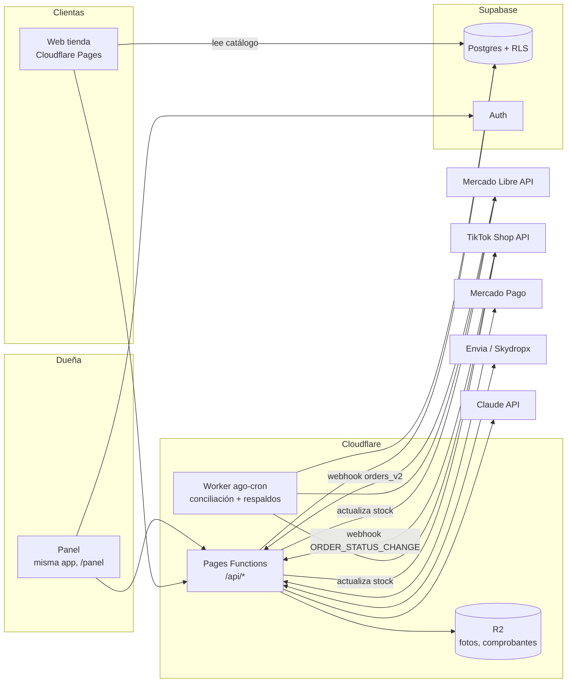
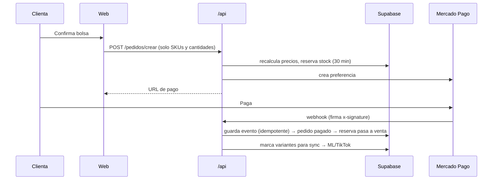

# Pupilentes AGO · Arquitectura y plan por fases

> Documento vivo. Es la guía para desarrollar el proyecto real con Claude, fase por fase.
> Última actualización: 8 nov 2026 · Estado: **Fase 0 por iniciar**

---

## 0. Cómo usar este documento

- Cada fase tiene: **objetivo → entregables → flujos a probar a mano → pruebas automáticas → criterio de terminado**.
- Una fase = una rama `fase/N-nombre` → PR a `develop` → cuando la fase está probada, PR de `develop` a `main` (producción).
- Al pedirle algo a Claude: "Trabajemos la Fase N de `docs/ARQUITECTURA.md`". Claude lee este archivo y `CLAUDE.md` antes de empezar.
- Al cerrar una fase se marcan sus casillas aquí y se actualiza el **Estado** de arriba.
- Lo marcado **⚠️ Decisión pendiente** no se construye hasta que se decida.

---

## 1. Contexto

**Negocio.** Pupilentes de color (estéticos y graduados para miopía) y accesorios. Vende por **web propia**, **Mercado Libre** y **TikTok Shop**. Hoy lleva el stock en Excel.

**Lo que vimos en sus canales (capturas, 8 nov 2026):**
- ML: marcas Urban Layer (líneas Cloud, Olivia, Siri, Maldives, Angeles N, Cleopatra, Gemini, Chelsea, Alaska, Memphis, Gogh N, Orlando…), Freshlady, accesorios (solución, estuches, gafas). Sin graduación visible. Envío "Llega gratis" (logística de ML).
- Publicaciones mezcladas: unas por **línea con colores como variantes**, otras por **color suelto** → un mismo producto físico puede estar en varias publicaciones.
- TikTok: se vende por **duración** (trimestral, semestral, anual) y por **diseño** (p. ej. Halloween, "14 opciones"). Envío con tarifa de TikTok.

**Reglas del negocio ya confirmadas:**
- Se vende **siempre por par** (1 unidad de stock = 1 caja/par). Nunca un ojo de una graduación y otro de otra.
- La clienta tiene **fotos por graduación** y un **catálogo ordenado en Drive** (fotos + nombre de producto).
- Pago en web hoy: transferencia.

**Lo que ya existe (demo v4.1, este repo):** landing, catálogo por familias con filtro de graduación, bolsa, checkout (Metro / DiDi / paquetería simulada), pago por transferencia con comprobante, rastreo, test de tono, probador/lookbook con cámara (MediaPipe), cuenta por WhatsApp con puntos, panel (Hoy · Pedidos · Inventario con Excel · Catálogo · Clientas) y chatbot con IA.
**Limitación:** todo menos el chatbot vive en `localStorage` del navegador. No hay base de datos ni login real. El stock está modelado **por pieza**; hay que cambiarlo **a par**.

---

## 2. Decisiones de infraestructura

| Pieza | Elección | Por qué | Costo |
|---|---|---|---|
| Frontend | **Cloudflare Pages** (Vite + React actual) | Mismo stack que JM Nutrólogo; uso comercial sin plan de pago | $0 · ancho de banda ilimitado, 500 builds/mes [3] |
| API / webhooks | **Cloudflare Pages Functions** (`/functions`) | Se cobran como Workers; mismo deploy que el frontend [2] | $0 hasta 100,000 req/día [1] |
| Tareas programadas | **Worker aparte `ago-cron`** con Cron Trigger | Pages Functions no tiene cron; el Worker sí | $0 (5 crons por cuenta en Free) [1] |
| Base de datos + Auth | **Supabase** (Postgres + Auth + RLS) | Ya lo usan; Auth y RLS listos | Ver §2.2 |
| Imágenes | **Cloudflare R2** | Muchas fotos (por graduación); sin costo de salida | $0 hasta 10 GB y 10 M lecturas/mes [5] |
| Pagos web | **Mercado Pago Checkout Pro** + transferencia | Ya tiene cuenta MP por ML; tarjeta, SPEI, OXXO, meses sin tarjeta [7] | 3.49% + IVA (dinero al instante) [8] |
| Envíos web | **Envia.com o Skydropx** ⚠️ | API de cotización + guía + rastreo | Por guía |
| Anti-bots | Cloudflare Turnstile | Ya integrado en el chatbot | $0 |
| Contadores / rate limit | Upstash Redis (ya integrado) | Ya funciona en el chatbot | Plan gratis |
| IA chatbot | Claude Haiku 5.5 (ya integrado) | Topes de costo ya implementados | Variable, con tope diario |
| Dominio | **Cloudflare Registrar** | Precio de mayoreo, sin margen [6] | Costo del registro |

### 2.1 Por qué salimos de Vercel
El plan Hobby de Vercel es **solo para uso personal no comercial**. Vercel define como comercial cualquier sitio que cobre a sus visitantes, anuncie la venta de productos o por el que alguien reciba pago por crearlo [4]. Esta tienda cumple las tres. Las opciones son Vercel Pro (de pago por miembro) o Cloudflare, que ya conocen. **Decisión: Cloudflare.** El link actual de Vercel se queda solo como demo hasta que la versión en Cloudflare esté arriba; después se apaga.

### 2.2 Supabase: ¿Free o Pro?
Datos del plan [9]:
- **Free:** límite de **2 proyectos activos**; se **pausan tras 1 semana sin actividad**; 500 MB de BD, 1 GB de archivos, 5 GB de salida.
- **Pro:** desde **$25 USD/mes por organización**, con $10 de crédito de cómputo que cubre 1 instancia Micro. Cada proyecto extra suma su cómputo (Micro = $10/mes). Ejemplo oficial: 2 proyectos Micro = **$35/mes**. 8 GB de BD por proyecto y respaldos diarios por 7 días.

**Números con el cobro actual ($3,000 MXN/año por clienta) y tipo de cambio de $18.79 [10]:**
- Costo Pro con *n* proyectos ≈ (15 + 10·n) USD/mes → **3,382 + 2,255·n MXN/año**.
- Ingreso ≈ **3,000·n MXN/año**.
- Cada proyecto extra deja ≈ $745 MXN/año de margen, pero la base de la organización cuesta ≈ $3,382/año.
- **Punto de equilibrio: 5 clientas** en Pro. Con 2 (JM + AGO) pagarían ≈ $7,892/año y cobrarían $6,000.

**Recomendación:**
1. **Ahora:** AGO va en el **2.º proyecto Free** (JM ocupa el 1.º). No se pausa porque el cron de conciliación la consulta cada pocos minutos. Como el Free no tiene respaldos diarios, hacemos un **respaldo propio diario** (`pg_dump` → R2) en la Fase 0.
2. **Cuando llegue la 3.ª clienta con BD:** pasar a una organización Pro. En ese momento, cobrar el hosting por separado o subir la anualidad. Con $3,000/año, cada clienta cubre su propio Micro, pero no la base de la organización hasta tener ~5.
3. **No** recomendamos meter dos clientas en el mismo proyecto de Supabase: mezcla datos de negocios distintos y una fuga en una afecta a la otra.

### 2.3 Límites que hay que vigilar (cuenta de Cloudflare compartida con JM)
- 100,000 peticiones/día a Functions en Free, sumando todos los proyectos de la cuenta [1].
- **10 ms de CPU por petición en Free** [1]. El tiempo esperando `fetch` no cuenta, pero cálculos pesados sí. Si algo se pasa, el plan Workers Paid cuesta **$5 USD/mes** e incluye 10 M de peticiones [2].
- **5 Cron Triggers por cuenta** en Free [1] (compartidos con JM). Se usa **un solo cron** que despacha todas las tareas.
- Supabase Free: 500 MB de BD. Las fotos **no** van en Supabase; van en R2.

---

## 3. Arquitectura



**Principio central: nuestra BD es la única fuente de verdad del stock.** Mercado Libre, TikTok y la web son *canales*. Cada venta, venga de donde venga, descuenta en nuestra BD, y la BD empuja la nueva cantidad a los demás canales.

### 3.1 Estructura de carpetas (objetivo)

```
/src                      Frontend (React)
  /pages  /panel  /chat  /ui
  /lib                    cliente Supabase (anon), helpers de UI
/functions                Cloudflare Pages Functions → rutas /api/*
  /api
    _middleware.js        CORS, headers, rate limit, errores
    chat.js
    catalogo/…            lecturas públicas cacheadas
    pedidos/crear.js      calcula precios EN SERVIDOR y reserva stock
    pagos/mp-crear.js
    envios/cotizar.js  envios/guia.js
    webhooks/mercadopago.js  webhooks/mercadolibre.js  webhooks/tiktok.js  webhooks/envios.js
    panel/…               rutas que exigen sesión de la dueña
/server                   Lógica de dominio compartida (NO se publica como ruta)
  stock.js  pedidos.js  precios.js
  /canales  ml.js  tiktok.js     (adaptadores con la misma interfaz)
  /pagos    mercadopago.js
  /envios   envia.js | skydropx.js
  seguridad.js            firmas HMAC, validación (zod), idempotencia
/workers/ago-cron         Worker con Cron Trigger
/supabase
  /migrations             SQL versionado (tablas, RLS, funciones)
  seed.sql                datos de prueba
  /tests                  pruebas de BD (pgTAP): RLS y funciones de stock
/scripts                  importar catálogo del Drive → BD + R2
/tests
  /unit                   Vitest
  /integracion            funciones + Supabase local
  /seguridad              ataques automatizados (ver §6)
  /e2e                    Playwright (al final, ver §7)
/docs                     este documento y manuales
```

### 3.2 Modelo de datos (borrador; se ajusta con el Drive del catálogo)

| Tabla | Campos clave | Notas |
|---|---|---|
| `marcas` | id, nombre | Urban Layer, Freshlady, … |
| `productos` | id, marca_id, nombre (línea/modelo), tipo (`lente` / `accesorio`), familia de color, descripción, activo | "Línea Cloud" |
| `variantes` | id, producto_id, **sku** (único), color/diseño, duración (`trimestral`/`semestral`/`anual`/null), **graduación** (null = neutro), precio, **stock** (en pares), stock_reservado, activo | Unidad = **par** |
| `imagenes` | id, producto_id, variante_id (null = general), graduación (opcional), url_r2, orden | Fotos por graduación |
| `publicaciones_canal` | id, variante_id, canal (`ml`/`tiktok`), id_externo_item, id_externo_variante, activo, ultimo_sync | **N publicaciones por variante** |
| `movimientos_stock` | id, variante_id, delta, motivo (`venta`/`ajuste`/`devolucion`/`reserva`/`liberacion`/`conciliacion`), canal, pedido_id, **ref_externa (única)**, usuario, creado_en | Bitácora: nunca se edita ni se borra |
| `pedidos` | id, folio, canal, id_externo, estado, clienta_id, subtotal, descuento, envío, total, entrega (jsonb), pago_estado, expira_reserva_en | |
| `pedido_items` | pedido_id, variante_id, cantidad, precio_unitario | Precio congelado al comprar |
| `pagos` | pedido_id, proveedor, id_externo, estado, monto, comprobante_url | MP o transferencia |
| `envios` | pedido_id, proveedor, servicio, guía, url_rastreo, estado, costo | |
| `clientas` | id, telefono (único), nombre, email, creado_en | |
| `puntos_movimientos` | clienta_id, delta, motivo, pedido_id | Saldo = suma (bitácora) |
| `eventos_webhook` | id, proveedor, **id_evento (único)**, payload, recibido_en, procesado_en, intentos, error | Idempotencia y reintentos |
| `integraciones` | canal, tokens **cifrados**, expira_en, cuenta_externa | Tokens OAuth de ML/TikTok |
| `perfiles_panel` | user_id (Supabase Auth), rol (`duena`/`ayudante`) | |

**Regla de oro del stock:** solo se modifica con una función SQL `mover_stock(variante, delta, motivo, ref)` que, en una sola transacción, (1) inserta en `movimientos_stock`, que rechaza duplicados por `ref_externa`; (2) actualiza `variantes.stock` sin dejarlo bajar de 0; (3) marca la variante para sincronizar con los canales. Nadie hace `UPDATE stock` directo.

### 3.3 Flujos principales

**A. Venta en la web con Mercado Pago**

- Si no paga en 30 min, el cron libera la reserva.
- **Transferencia:** el pedido queda `pendiente_validacion`; la dueña aprueba el comprobante en el panel y entonces se descuenta.

**B. Venta en Mercado Libre**
1. ML manda POST con tópico `orders_v2`. Respondemos **200 de inmediato** (si no, reintenta durante 1 hora y luego descarta) [11].
2. Guardamos el evento y, en segundo plano (`waitUntil`), consultamos la orden en la API de ML con nuestro token. Así validamos que es real, porque ML no firma sus avisos.
3. `mover_stock` por cada ítem, usando `ref = ml:order_id:item`. Empujamos el stock nuevo a las **otras** publicaciones de esa variante (incluidas las otras de ML) y a TikTok.

**C. Venta en TikTok Shop**
1. Evento `ORDER_STATUS_CHANGE`. Validamos la firma HMAC-SHA256 y respondemos **200 en menos de 3 s** [12].
2. TikTok entrega **al menos una vez** (puede duplicar) y reintenta 4 veces (≈2 min, 30 min, 3 h, 12 h) antes de perder el evento [12]. Por eso deduplicamos por `tts_notification_id` y conciliamos.
3. Mismo paso 3 que en ML.

**D. Conciliación (cron cada ~10 min)**
- Trae las órdenes recientes de ML y TikTok y procesa las que no tengamos. Esto cubre los webhooks perdidos.
- Compara nuestro stock contra el publicado en cada canal y corrige diferencias.
- Libera reservas vencidas y reintenta eventos fallidos.
- Una vez al día: respaldo de la BD a R2.

**E. Cancelación / devolución:** `mover_stock(+cantidad, 'devolucion')`, solo si el producto regresa en condiciones de venderse (lo confirma la dueña en el panel).

---

## 4. Ambientes

| Ambiente | Frontend | API | BD | Pagos |
|---|---|---|---|---|
| Local | `npm run dev` | `wrangler pages dev` | **Supabase local** (`supabase start`, Docker) | MP sandbox |
| Preview (`develop` y ramas) | URL de preview de Cloudflare | Functions de preview | ⚠️ Decisión pendiente | MP sandbox |
| Producción (`main`) | Dominio de la clienta | Functions | Supabase (proyecto AGO) | MP real |

⚠️ **Decisión pendiente: BD de preview.** En Free no hay un 3.er proyecto para *staging*. Opciones: (a) preview usa la BD de producción con datos de prueba marcados (riesgoso); (b) preview solo con frontend y datos falsos, y la integración se prueba en local; (c) pagar un Micro extra ($10/mes) para staging. **Propuesta: (b) mientras estemos en Free.**

---

## 5. Fases

> Orden pensado para entregar valor pronto y reducir riesgos. **Trámites externos (app de ML, Partner de TikTok, cuenta de paquetería) se inician en la Fase 0** porque tardan; la revisión del vendedor de prueba de TikTok puede tardar de 3 a 7 días hábiles [13].

### Fase 0 · Cimientos
**Objetivo:** la demo actual corriendo igual, pero en Cloudflare + Supabase, con el repo listo para trabajar en equipo.
- [ ] Ramas `main` (protegida, solo con PR) y `develop`; tag `demo-v1` en el estado actual.
- [ ] Proyecto en **Cloudflare Pages** conectado al repo; previews por rama.
- [ ] Mover `api/chat.js` a `functions/api/chat.js` (ya usa `Request`/`Response` estándar, el cambio es menor); variables de entorno en Cloudflare.
- [ ] Proyecto **Supabase** (2.º Free) + Supabase CLI + carpeta `supabase/migrations`.
- [ ] Bucket **R2** para imágenes.
- [ ] Estructura de carpetas de §3.1, `.env.example` actualizado, `CLAUDE.md`.
- [ ] CI en GitHub Actions: lint + build + `npm audit` + escaneo de secretos (gitleaks).
- [ ] Respaldo diario de BD → R2 (en el Worker `ago-cron`).
- [ ] **Iniciar trámites:** app de Mercado Libre, cuenta Partner de TikTok Shop, cuenta de Envia/Skydropx (sandbox).
- [ ] Sacar `Cotizacion_Pupilentes_AGO.pdf` del repo (o meterlo a `.gitignore`).

**Flujos a probar a mano:** abrir la web en la URL de Cloudflare; el chatbot responde; las previews de rama funcionan.
**Pruebas automáticas:** CI pasa en cada PR.
**Terminado cuando:** la demo en Cloudflare es idéntica a la de Vercel y el chatbot funciona en producción.

### Fase 1 · Modelo de datos y catálogo real
**Objetivo:** la tienda muestra el catálogo real de la clienta desde la BD.
- [ ] Migraciones de §3.2 con **RLS en todas las tablas** (público: solo lectura del catálogo activo).
- [ ] Función `mover_stock` + pruebas pgTAP.
- [ ] Script `scripts/importar-catalogo`: Drive → R2 (fotos optimizadas a WebP, nombres normalizados) y BD (marcas, productos, variantes, imágenes por graduación).
- [ ] Importar el stock inicial desde su Excel.
- [ ] Frontend: tienda, ficha de producto y filtros leen de la BD. Selector: color/diseño → duración → graduación (o "sin graduación"). Siempre **por par**.
- [ ] Accesorios como productos simples.

**Flujos a probar a mano:** navegar el catálogo completo, filtrar por graduación, ver las fotos correctas por graduación y comprobar que un producto sin stock se ve agotado.
**Pruebas automáticas:** pgTAP (RLS: anónimo no ve pedidos, clientas ni costos; `mover_stock` no baja de 0 y rechaza `ref` duplicada); unitarias de mapeo del importador.
**Terminado cuando:** el 100% del catálogo del Drive está en la web con fotos y stock correctos (revisado con la clienta).

### Fase 2 · Panel seguro e inventario
**Objetivo:** la dueña administra catálogo e inventario de verdad.
- [ ] Login de panel con Supabase Auth (correo + contraseña) y **MFA**; roles `duena`/`ayudante`.
- [ ] Inventario: ajustes con motivo (pasan por `mover_stock`), historial por variante, alertas de stock bajo.
- [ ] Importar/exportar Excel contra la BD (con vista previa de cambios antes de aplicar).
- [ ] Catálogo: alta/edición de productos, variantes e imágenes (subida a R2 con URL firmada).
- [ ] Bitácora visible de quién cambió qué.

**Flujos a probar a mano:** entrar al panel, ajustar stock, importar un Excel con errores (debe avisar sin aplicar nada), subir una foto.
**Pruebas automáticas:** sin sesión, `/api/panel/*` da 401; con rol `ayudante` no se puede borrar productos; un Excel malformado no modifica la BD.
**Terminado cuando:** la dueña puede dejar su Excel y operar solo desde el panel.

### Fase 3 · Pedidos y pagos en la web
**Objetivo:** vender en la web con pago real.
- [ ] `POST /api/pedidos/crear`: **precios y totales calculados en servidor**, validación con zod, reserva de stock por 30 min, Turnstile.
- [ ] Mercado Pago Checkout Pro: preferencia, regreso a la web, webhook con verificación de firma, idempotencia.
- [ ] Transferencia: comprobante a R2 (tipo y tamaño validados) y aprobación en el panel.
- [ ] Estados de pedido: `pendiente_pago → pagado → preparando → enviado → entregado` (+ `cancelado`).
- [ ] Panel de pedidos conectado a la BD; mensajes de WhatsApp prellenados (ya existen).
- [ ] Rastreo público `/pedido/:folio`, que pide folio **y** últimos 4 dígitos del teléfono.

**Flujos a probar a mano:** compra con tarjeta de prueba de MP; compra con OXXO de prueba; compra por transferencia aprobada desde el panel; pago abandonado (la reserva se libera); dos personas compran la última pieza al mismo tiempo (solo una lo logra).
**Pruebas automáticas:** cambiar el precio en la petición no cambia lo cobrado; webhook con firma falsa → 401; el mismo webhook 2 veces → un solo descuento.
**Terminado cuando:** 10 compras de prueba seguidas sin descuadre de stock.

### Fase 4 · Envíos
**Objetivo:** cotizar y generar guías reales desde el panel.
- [ ] ⚠️ Elegir proveedor (Envia.com o Skydropx) según tarifas reales para su peso y volumen.
- [ ] Cotizador por CP en el checkout (reemplaza el simulado).
- [ ] "Generar guía" en el panel → PDF de la guía + número de rastreo al pedido.
- [ ] Webhook o consulta de rastreo → actualiza el estado del pedido.
- [ ] Metro y DiDi: agenda de entregas en el panel (sin API).

**Flujos a probar a mano:** cotizar a 3 CP distintos, generar guía sandbox, ver el rastreo en la página del pedido.
**Pruebas automáticas:** CP inválido → error claro; si la API de paquetería falla, se muestra un mensaje amable y se registra el error.
**Terminado cuando:** un envío real llega con su guía generada desde el panel.

### Fase 5 · Mercado Libre
**Objetivo:** las ventas en ML descuentan stock y el stock se refleja en ML.
- [ ] App en el portal de desarrolladores de ML, OAuth de la cuenta de la clienta y tokens cifrados con refresco automático.
- [ ] Pantalla en el panel para **vincular publicaciones ↔ variantes** (soporta N publicaciones por variante).
- [ ] Webhook `orders_v2` (y `items` si conviene) → `mover_stock`.
- [ ] Empuje de stock a ML al cambiar una variante.
- [ ] Conciliación en `ago-cron`.
- [ ] ⚠️ Confirmar si usa **Full** (bodega de ML): ese stock es de ML y no se empuja.

**Flujos a probar a mano:** compra real de bajo costo en ML → baja el stock en el panel y en las otras publicaciones; ajuste en el panel → cambia en ML.
**Pruebas automáticas:** evento duplicado → un solo descuento; un evento de otra cuenta se ignora; webhook caído 2 horas → la conciliación lo recupera.
**Terminado cuando:** una semana en producción sin descuadres entre ML y la BD.

### Fase 6 · TikTok Shop
**Objetivo:** lo mismo que la Fase 5, para TikTok.
- [ ] App en TikTok Shop Partner Center (iniciada en la Fase 0) y autorización de la **titular** de la tienda.
- [ ] Webhook `ORDER_STATUS_CHANGE` con verificación HMAC, respuesta < 3 s y procesamiento con `waitUntil`.
- [ ] Vinculación de SKUs de TikTok ↔ variantes; empuje de inventario; conciliación.

**Flujos a probar a mano:** igual que la Fase 5.
**Pruebas automáticas:** firma inválida → 401; mismo `tts_notification_id` → un solo descuento.
**Terminado cuando:** una semana sin descuadres en los 3 canales.

### Fase 7 · Cuenta de clienta y puntos
- [ ] ⚠️ Login de clienta: código por **correo** (gratis con Supabase) o por **WhatsApp/SMS** (requiere proveedor y cuesta por mensaje).
- [ ] Puntos como bitácora (`puntos_movimientos`); se ganan al pagarse un pedido y se usan en el checkout (validado en servidor).
- [ ] Historial de pedidos, guías y recompra en 1 clic.
- [ ] Receta/graduación guardada ⚠️ (ver §8, datos sensibles).

**Pruebas automáticas:** una clienta no puede ver pedidos ni puntos de otra (RLS); no se pueden usar más puntos de los que hay.

### Fase 8 · Chatbot conectado al catálogo real
- [ ] La base de conocimiento lee precios, tonos y disponibilidad de la BD (cacheado), en lugar de `chatbot-kb.js` fijo.
- [ ] Se mantienen todos los límites de costo actuales.

### Fase 9 · Endurecimiento, pruebas E2E y lanzamiento
- [ ] Suite **E2E automatizada** con Playwright (§7) corriendo en CI contra preview.
- [ ] Escaneo OWASP ZAP *baseline* contra preview.
- [ ] Dominio (Cloudflare Registrar), DNS, HTTPS, `_headers` con CSP.
- [ ] SEO: cambiar `HashRouter` → `BrowserRouter` (URLs limpias), metadatos, sitemap.
- [ ] Analítica (Cloudflare Web Analytics, sin cookies).
- [ ] Monitoreo: alertas si fallan webhooks, la conciliación o el respaldo.
- [ ] Aviso de privacidad y términos ⚠️.
- [ ] Manual corto para la clienta y entrega.

---

## 6. Seguridad

### 6.1 Reglas que se cumplen desde el día 1
1. **RLS activado en todas las tablas.** El navegador solo usa la llave `anon`; la `service_role` vive **solo** en variables de entorno de Cloudflare.
2. **Nunca confiar en el navegador:** precios, totales, descuentos, puntos y stock se calculan en el servidor.
3. **Validación de entrada** con zod en cada `/api`; límites de tamaño.
4. **Webhooks:** verificar firma (MP `x-signature`, TikTok HMAC-SHA256); ML se valida consultando su API con nuestro token; **idempotencia** por id de evento.
5. **Rate limit** por IP en rutas públicas y Turnstile en checkout y login.
6. **Secretos** fuera del repo; tokens OAuth **cifrados** en la BD; escaneo de secretos en CI.
7. **Archivos:** subida con URL firmada, tipos permitidos (jpg/png/webp/pdf), tamaño máximo; comprobantes en un bucket **privado**.
8. **Panel** con MFA y roles; sesión con expiración.
9. **Headers:** CSP, `X-Frame-Options`, `Referrer-Policy`, HSTS (archivo `_headers` de Pages).
10. **Logs sin datos personales** (sin teléfonos ni direcciones completas).
11. **Dependencias:** `npm audit` en CI; Dependabot.
12. **Respaldos** diarios y prueba de restauración una vez por fase.

### 6.2 Pruebas de seguridad (automatizadas, en `tests/seguridad`)
| Ataque | Resultado esperado |
|---|---|
| Leer `pedidos`/`clientas` con la llave anon | 0 filas / error |
| Clienta A pide datos de clienta B | Denegado (RLS) |
| `POST /pedidos/crear` con precio o total alterado | Se cobra el precio de la BD |
| Usar más puntos de los disponibles | Rechazado |
| Webhook con firma falsa | 401 y nada cambia |
| Mismo webhook repetido (replay) | 1 solo movimiento de stock |
| Comprar la última pieza 2 veces en paralelo | 1 éxito, 1 "agotado" |
| `/api/panel/*` sin sesión / con rol `ayudante` en acción de dueña | 401 / 403 |
| Ver pedido ajeno cambiando el folio (IDOR) | Denegado sin los 4 dígitos del teléfono |
| Subir `.html`/`.svg`/archivo de 50 MB como comprobante | Rechazado |
| Ráfaga de 100 peticiones/min a una ruta pública | 429 |
| Origen no permitido en `/api/chat` | 403 (ya existe) |

---

## 7. Estrategia de pruebas

| Nivel | Herramienta | Cuándo |
|---|---|---|
| Unitarias (precios, stock, mapeos) | **Vitest** | Desde la Fase 1, en cada PR |
| BD (RLS, `mover_stock`) | **pgTAP** (`supabase test db`) | Desde la Fase 1, en cada PR |
| Integración (functions + Supabase local + sandbox) | Vitest + `wrangler` | Desde la Fase 3 |
| Seguridad | `tests/seguridad` + ZAP baseline | Cada fase suma sus casos; ZAP en la Fase 9 |
| **Flujos manuales** | Checklist de cada fase (arriba) | Mientras construimos: ustedes prueban, Claude corrige |
| **Flujos E2E automáticos** | **Playwright** | Fase 9: Claude convierte los checklists manuales en pruebas automáticas |

**Flujos E2E de la Fase 9 (mínimo):**
1. Clienta compra un lente neutro con MP (sandbox) → pedido pagado → stock baja.
2. Clienta compra un graduado por transferencia → la dueña aprueba → stock baja.
3. Pago abandonado → la reserva se libera.
4. La dueña inicia sesión con MFA → ajusta stock → se refleja en la tienda.
5. La dueña genera una guía → la clienta ve el rastreo.
6. Venta simulada de ML (webhook de prueba) → baja el stock en la web y en TikTok (mock).
7. Clienta entra a su cuenta → ve sus puntos → los usa en una compra.
8. Chatbot: pregunta rápida (sin IA) y pregunta libre (con tope).
9. Vista móvil de tienda y panel (iPhone / Android en Playwright).

---

## 8. A tomar en cuenta (riesgos y pendientes)

- **Sobreventa:** entre una venta y la actualización en los demás canales pasan segundos. Mitigación: reservas, conciliación y opción de **stock de colchón** por canal (p. ej. no publicar en ML las últimas 1–2 piezas). ⚠️ Lo decide la clienta.
- **Publicaciones duplicadas en ML** (línea con variantes + color suelto): la vinculación debe permitir varias publicaciones por variante.
- **Graduados:** si solo se venden en la web/WhatsApp, la sincronización con canales solo toca los neutros. ⚠️ Confirmar.
- **Full de ML:** si tiene stock en bodega de ML, ese inventario se maneja aparte. ⚠️ Confirmar.
- **Tokens de ML/TikTok caducan:** refresco automático y alerta si falla la autorización.
- **Trámites externos** (TikTok Partner, app ML, paquetería) tardan días → iniciarlos en la Fase 0.
- **Fiscal:** en 2026 las plataformas retienen a personas físicas 2.5% de ISR y, sin RFC válido, el 100% del IVA [14]. ⚠️ Que la clienta confirme con su contador que su RFC esté dado de alta en Mercado Pago. (No somos asesores fiscales.)
- **Datos personales:** se guardan nombre, teléfono, dirección y posiblemente receta o graduación. ⚠️ Se necesita **aviso de privacidad** y validar con un asesor legal si la receta se trata como dato sensible y si la venta de lentes graduados tiene requisitos regulatorios. No lo asumimos; se confirma antes de la Fase 7.
- **Regla de contenido:** nunca mencionar el nombre de la dueña en la web pública.
- **Cuenta de Cloudflare compartida con JM:** los límites Free (peticiones/día, crons) se suman entre proyectos.

---

## 9. Pendientes de la clienta

- [ ] Drive del catálogo (fotos por graduación + nombres) — prometido para el 9 nov 2026.
- [ ] Excel de stock actual.
- [ ] ¿Graduados también en ML/TikTok o solo web?
- [ ] ¿Usa Full de ML?
- [ ] ¿RFC dado de alta en Mercado Pago?
- [ ] Confirmar Mercado Pago + transferencia como pagos de la web.
- [ ] Accesos: cuenta de ML y TikTok Shop (para autorizar las apps), cuenta de Mercado Pago (credenciales de integración).
- [ ] Datos reales: precios web, historia de la marca, datos bancarios, políticas de envío y devolución.

---

## Fuentes

1. Cloudflare — Workers limits (Free: 100,000 req/día, 10 ms CPU, 5 Cron Triggers): https://developers.cloudflare.com/workers/platform/limits/
2. Cloudflare — Workers pricing (Paid: mínimo $5/mes, 10 M req incluidas; Pages Functions se cobran como Workers): https://developers.cloudflare.com/workers/platform/pricing/
3. Temps — Cloudflare Pages free tier limits 2026 (500 builds/mes, ancho de banda ilimitado, 100 proyectos): https://temps.sh/blog/cloudflare-pages-free-tier-limits-2026
4. Vercel — Fair Use Guidelines, "Commercial usage": https://vercel.com/docs/limits/fair-use-guidelines
5. Upstash KB — Cloudflare R2 pricing 2026 (10 GB, 1 M clase A, 10 M clase B, salida gratis): https://upstash.com/kb/cloudflare-r2-pricing-in-2026-storage-operations-and-real-monthly-bills
6. Cloudflare — Registrar: https://developers.cloudflare.com/registrar
7. Mercado Pago — Checkout Pro: https://www.mercadopago.com.mx/developers/en/docs/checkout-pro/landing
8. Mercado Pago — Tarifas: https://www.mercadopago.com.mx/herramientas-para-vender/check-out
9. Supabase — Pricing: https://supabase.com/pricing
10. UnoTV — Dólar en $18.79 (3 nov 2026): https://www.unotv.com/dolar-hoy/dolar-cotiza-en-18-79-pesos-este-martes-3-de-noviembre-de-2026/
11. Mercado Libre — Recibe notificaciones: https://developers.mercadolibre.com.ar/en_us/products-receive-notifications
12. Hookdeck — TikTok Shop webhooks: https://hookdeck.com/webhooks/platforms/guide-to-tiktok-shop-webhooks-features-and-best-practices
13. EchoTik — TikTok Shop API integration: https://www.echotik.live/blog/tiktok-shop-api-integration-automate-orders-inventory/
14. El Contribuyente — Retenciones 2026 en plataformas digitales: https://www.elcontribuyente.mx/2025/11/en-2026-vender-en-plataformas-digitales-sera-mas-caro-habra-nuevas-retenciones/
