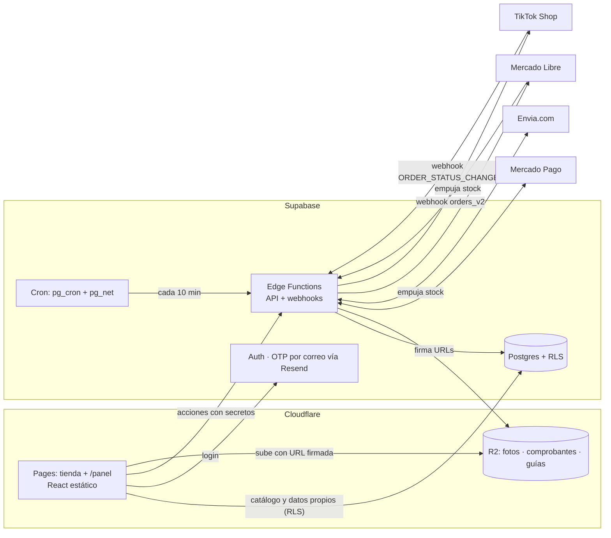
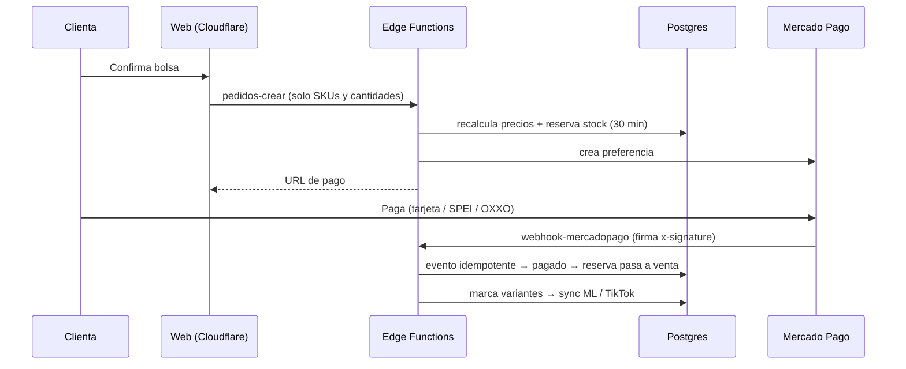

# Pupilentes AGO · Arquitectura y plan por fases

> Documento vivo. Es la guía para que cualquier persona del equipo (con Claude) desarrolle el proyecto real, fase por fase.
> **Cubre el 100% del proyecto:** frontend, backend, base de datos, integraciones, seguridad, pruebas y lanzamiento.
> Repo: `hummingxbi-source/Pupilentes-AGO` · Última actualización: 8 nov 2026 · **Estado: Fase 0 por iniciar**
>
> Documentos relacionados: [`README.md`](../README.md) (cómo empezar) · [`docs/FRONTEND.md`](FRONTEND.md) (la demo como punto de partida del diseño).

---

## 0. Cómo trabajamos

### 0.1 Ramas (regla principal)

| Rama | Para qué | Quién la toca |
|---|---|---|
| **`demo`** | **Copia congelada de la demo** que vio la clienta (incluye el chatbot). Es la referencia de "lo que ideamos". No se modifica. | Nadie (protegida) |
| **`main`** | **El proyecto real.** Siempre debe compilar y funcionar en local. | Solo se actualiza con PR |
| `fase/N-nombre` | Trabajo de una fase o tarea. Sale de `main` y regresa a `main` con PR. | Quien desarrolla |

- La demo también queda marcada con el tag **`demo-v1`** (mismo commit que la rama `demo`).
- **Se trabaja y se prueba en local** (frontend + Supabase local). No hay nada publicado del proyecto nuevo hasta que se decida desplegar.
- Para recuperar algo de la demo, por ejemplo el chatbot: `git checkout demo -- src/chat` o abrir la rama `demo`.
- Para pedirle algo a Claude: "Trabajemos la Fase N de `docs/ARQUITECTURA.md`".
- Al cerrar una tarea se marca su casilla; al cerrar una fase se actualiza el **Estado** de arriba y el **Registro de cambios** (§10).
- **⚠️** = decisión pendiente; no se construye hasta decidirla.

### 0.2 ¿Qué pasa con la demo en Vercel? (decidido)
**Se desconecta el repo de Vercel; no se borra nada.** En Vercel: proyecto → *Settings* → *Git* → *Disconnect*.
- El link que tiene la clienta **sigue funcionando** con la demo tal cual está, pero ya no se actualiza con los cambios del repo.
- **Hay que desconectarlo antes de subir código a `main`.** Mientras siga conectado, cada push a `main` se publica en el link de la clienta.
- Más adelante, cuando el proyecto nuevo se despliegue en Cloudflare, se borra el proyecto de Vercel. El plan Hobby de Vercel es solo para uso personal no comercial [4], así que no se usa para producción.

---

## 1. Alcance

**Proyecto real = funcionalidades de la demo hechas reales + Mercado Pago + sincronización de stock con Mercado Libre y TikTok Shop.**

| Módulo | En la demo | En el proyecto real |
|---|---|---|
| Landing, catálogo por familias, filtro de graduación | Datos fijos en código | Lee de la BD |
| Test de tono, probador/lookbook con cámara | Solo frontend | Se conserva |
| Bolsa y checkout (Metro / DiDi / paquetería) | Cotizador simulado | **Envia.com** real + Metro/DiDi con agenda |
| Pago por transferencia con comprobante | Simulado | Real, aprobado desde el panel |
| **Pago con Mercado Pago** | — | **Nuevo** (Checkout Pro) |
| Rastreo de pedido | Simulado | Real (folio + teléfono) |
| Cuenta de clienta con puntos | Simulado | Login con **código por correo** (gratis) + puntos reales |
| Panel: Hoy · Pedidos · Inventario (Excel) · Catálogo · Clientas | `localStorage`, sin login | BD real, login con MFA |
| **Sincronización de stock con ML y TikTok** | — | **Nuevo** |
| Chatbot | Existe | **Fuera de alcance** (fase futura). Se oculta con `VITE_CHATBOT=false`; el código se conserva. |
| Aviso de privacidad / términos | — | Al final (Fase 9) |

**Lo que vimos en sus canales (capturas, 8 nov 2026):**
- ML: Urban Layer (líneas Cloud, Olivia, Siri, Maldives, Angeles N, Cleopatra, Gemini, Chelsea, Alaska, Memphis, Gogh N, Orlando, Las Vegas…) a $799; Freshlady $299–$310; accesorios (solución Renu $129, estuches $139–$179, kit de estuches, gafas $149). Sin graduación visible. Envío con logística de ML.
- Publicaciones mezcladas: por línea con colores como variantes y por color suelto. Un producto físico puede estar en varias publicaciones.
- TikTok: por **duración** (trimestral $289, semestral, anual $590) y por **diseño** (Halloween, "14 opciones"). Envío de TikTok.

**Reglas de negocio:** se vende **siempre por par** (1 unidad = 1 caja, misma graduación en ambos ojos). La clienta tiene fotos por graduación en un Drive, pero **no dependemos de él para avanzar**. Pagos web: transferencia + Mercado Pago.

---

## 2. Infraestructura

**Resumen: frontend y archivos en Cloudflare; backend y base de datos en Supabase.**

| Pieza | Elección | Por qué | Costo |
|---|---|---|---|
| Frontend | **Cloudflare Pages** (Vite + React actual) | Mismo esquema que JM Nutrólogo | $0 · ancho de banda ilimitado, 500 builds/mes [3] |
| Backend (API y webhooks) | **Supabase Edge Functions** (Deno/TypeScript) | Todo el backend junto a la BD | $0 · 500,000 invocaciones/mes en Free [9] |
| Tareas programadas | **Supabase Cron** (`pg_cron` + `pg_net` llamando a una Edge Function) | Viene incluido; los secretos se guardan en Vault [20] | $0 |
| BD + Auth | **Supabase** (Postgres + RLS + Auth) | Ya lo usan | 2.º proyecto Free (§2.2) |
| Archivos (fotos, comprobantes, guías PDF) | **Cloudflare R2**, **nunca** Supabase Storage | Supabase Free da solo 1 GB de archivos [9] | $0 hasta 10 GB/mes; salida gratis [5] |
| Respaldos de BD | **GitHub Actions** programado (`supabase db dump` → R2) | Las Edge Functions no pueden correr `pg_dump` | $0 dentro de los minutos gratis de GitHub |
| Pagos web | **Mercado Pago Checkout Pro** + transferencia | Ya tiene cuenta MP por ML; tarjeta, SPEI, OXXO, meses sin tarjeta [7] | 3.49% + IVA (dinero al instante) [8] |
| Envíos web | **Envia.com** | Sin mensualidad [15]; API con sandbox, guías PDF, rastreo y webhooks [16] | Guía (la paga la clienta en el checkout) |
| Correos (login y avisos) | **Resend** como SMTP de Supabase Auth | El SMTP propio de Supabase solo manda 4 correos/hora [17] | $0: 100/día, 3,000/mes [18] |
| Anti-bots | Cloudflare Turnstile (ya integrado) | Checkout y login | $0 |
| Dominio | **Cloudflare Registrar** | Precio de mayoreo, sin margen [6] | Costo del registro |

**¿Por qué Envia.com y no Skydropx?** Ninguno cobra mensualidad: Envia.com dice "paga sólo por lo que envíes, sin mensualidades" [15], y Skydropx cobra por envío, sin contratos ni mínimos [19]. Pero Envia.com publica su API con ambiente de pruebas (`api-test.envia.com`) y webhooks de rastreo [16]; de Skydropx no encontramos documentación pública de API.

**¿Por qué login por correo?** Es gratis (Supabase + Resend). WhatsApp y SMS cobran por mensaje. Límite: 100 correos al día en Resend gratis [18]. Resend necesita el **dominio de la clienta verificado**; en desarrollo, Supabase local captura los correos sin enviarlos.

### 2.1 Límites de las Edge Functions [21]
- **2 s de CPU por petición** (esperar red o BD no cuenta).
- **150 s** máximo de vida por instancia en Free (400 s en Pro).
- 256 MB de memoria; hasta 100 funciones por proyecto en Free.
- Para responder rápido a un webhook y procesar después: `EdgeRuntime.waitUntil(promesa)`. La instancia sigue viva hasta terminar la promesa, dentro de esos límites [22].
- Los webhooks externos (ML, TikTok, MP, Envia) no traen sesión de Supabase. Esas funciones se despliegan con `verify_jwt = false` y **validan su propia firma**.

### 2.2 Supabase: plan y almacenamiento (⚠️ decisión final antes del lanzamiento)
Datos [9]:
- **Free:** 2 proyectos activos; se pausan tras 1 semana sin actividad; **500 MB de BD, 1 GB de archivos**, 5 GB de salida.
- **Pro:** $25 USD/mes por organización con $10 de crédito (cubre 1 proyecto Micro); cada proyecto extra suma ~$10/mes; 8 GB de BD y 100 GB de archivos; respaldos diarios de 7 días.

**El problema de JM Nutrólogo:** se llena en 2.5–3 meses porque los PDFs e imágenes van en Supabase Storage (1 GB).

**Propuesta (aplica a JM y a AGO):**
1. **Archivos en R2, no en Supabase.** R2 da 10 GB gratis con salida gratis [5]. Al ritmo de JM (≈1 GB cada 2.5–3 meses), alcanza para ≈25–30 meses; después cada GB cuesta $0.015 USD/mes [5]. Supabase solo guarda la URL.
2. **Comprimir al subir:** imágenes a WebP en el navegador, con tamaño máximo.
3. **AGO en el 2.º proyecto Free.** Sin archivos dentro, 500 MB de filas alcanzan para mucho. Se monitorea el tamaño.
4. **Pausa por inactividad:** el cron de conciliación llama cada 10 min. ⚠️ En la Fase 0 hay que verificar que eso cuente como actividad para Supabase.
5. **Pasar a Pro** con una 3.ª clienta con BD, o si una BD pasa ~400 MB. Con $3,000 MXN/año por clienta, Pro se paga solo a partir de **~5 clientas** (dólar a $18.79 [10]: costo ≈ 3,382 + 2,255·n MXN/año contra ingreso de 3,000·n).
6. ⚠️ **R2 es por cuenta de Cloudflare:** si JM y AGO comparten cuenta, comparten los 10 GB gratis.

---

## 3. Arquitectura



**Principio central:** nuestra BD es la única fuente de verdad del stock. La web, Mercado Libre y TikTok son canales.

**Qué va directo a la BD y qué pasa por Edge Functions:**
- **Directo (supabase-js + RLS):** leer catálogo; la clienta lee sus pedidos y puntos; el panel lee y edita catálogo y clientas.
- **Edge Function (lleva secretos o reglas que no pueden quedar en el navegador):** crear pedido (precios en servidor), pagos, envíos, mover stock, firmar subidas a R2, webhooks, conciliación y todo lo de ML y TikTok.

### 3.1 Estructura de carpetas (objetivo)

```
/src                        Frontend (React) → Cloudflare Pages
  /pages  /panel  /ui
  /chat                     (fuera de alcance; oculto con VITE_CHATBOT=false)
  /lib                      cliente Supabase (llave anon / publishable)
/supabase
  config.toml
  /migrations               SQL versionado: tablas, RLS, funciones (mover_stock), crons
  seed.sql                  catálogo semilla (Fase 1)
  /tests                    pgTAP: RLS y stock
  /functions                Edge Functions (Deno/TS)
    /_shared                stock.ts precios.ts seguridad.ts (firmas, zod, idempotencia)
                            canales/ml.ts canales/tiktok.ts  pagos/mercadopago.ts
                            envios/envia.ts  r2.ts
    /pedidos-crear
    /pagos-mp-crear
    /envios-cotizar  /envios-guia
    /r2-firmar-subida
    /panel-stock            ajustes de inventario (rol dueña)
    /webhook-mercadopago  /webhook-mercadolibre  /webhook-tiktok  /webhook-envia
    /cron-conciliar         lo invoca Supabase Cron
/scripts
  importar-catalogo         Excel/CSV + carpeta de fotos → BD + R2
/plantillas
  catalogo.xlsx             plantilla del catálogo
/tests
  /unit  /integracion  /seguridad  /e2e
/.github/workflows          CI + respaldo diario
/docs                       este documento
/api                        (demo, Vercel; se elimina de main en la Fase 0 — sigue en la rama demo)
```

### 3.2 Modelo de datos

| Tabla | Campos clave | Notas |
|---|---|---|
| `marcas` | id, nombre | Urban Layer, Freshlady, … |
| `productos` | id, marca_id, nombre (línea/modelo), tipo (`lente`/`accesorio`), familia de color, descripción, activo | "Línea Cloud" |
| `variantes` | id, producto_id, **sku** (único), color/diseño, duración (`trimestral`/`semestral`/`anual`/null), **graduación** (null = neutro), precio, **stock** (pares), stock_reservado, activo | Unidad = **par** |
| `imagenes` | id, producto_id, variante_id (null = general), graduación (opcional), url_r2, orden | Fotos por graduación |
| `publicaciones_canal` | id, variante_id, canal (`ml`/`tiktok`), id_externo_item, id_externo_variante, activo, ultimo_sync | **N publicaciones por variante** |
| `movimientos_stock` | id, variante_id, delta, motivo (`venta`/`ajuste`/`devolucion`/`reserva`/`liberacion`/`conciliacion`), canal, pedido_id, **ref_externa (única)**, usuario, creado_en | Bitácora: nunca se edita ni se borra |
| `pedidos` | id, folio, canal, id_externo, estado, clienta_id, subtotal, descuento, envío, total, entrega (jsonb), pago_estado, expira_reserva_en | |
| `pedido_items` | pedido_id, variante_id, cantidad, precio_unitario | Precio congelado |
| `pagos` | pedido_id, proveedor (`mercadopago`/`transferencia`), id_externo, estado, monto, comprobante_url | |
| `envios` | pedido_id, proveedor, servicio, guía, url_rastreo, estado, costo, etiqueta_url | |
| `clientas` | id (= auth.users.id), telefono, nombre, email, creado_en | |
| `puntos_movimientos` | clienta_id, delta, motivo, pedido_id | Saldo = suma |
| `eventos_webhook` | id, proveedor, **id_evento (único)**, payload, recibido_en, procesado_en, intentos, error | Idempotencia |
| `integraciones` | canal, tokens **cifrados**, expira_en, cuenta_externa | OAuth de ML/TikTok |
| `perfiles_panel` | user_id, rol (`duena`/`ayudante`) | |

**Regla de oro del stock:** solo cambia con la función SQL `mover_stock(variante, delta, motivo, ref)`. En una sola transacción: (1) inserta en `movimientos_stock`, rechazando `ref_externa` repetida; (2) actualiza `variantes.stock` sin bajar de 0; (3) marca la variante para sincronizar. Nadie hace `UPDATE stock` directo. Solo la ejecutan las Edge Functions con la llave de servicio.

### 3.3 Flujos principales

**A. Venta web con Mercado Pago**

- Sin pago en 30 min (OXXO: según su vigencia), el cron libera la reserva.
- **Transferencia:** pedido en `pendiente_validacion`; la dueña aprueba el comprobante en el panel y entonces se descuenta.

**B. Venta en Mercado Libre:** aviso `orders_v2` → respondemos **200 de inmediato**; si no, ML reintenta durante 1 hora y luego lo descarta [11] → `waitUntil`: consultamos la orden con nuestro token (ML no firma sus avisos, así validamos que sea real) → `mover_stock` (`ref = ml:order:item`) → empujamos el stock a las otras publicaciones y a TikTok.

**C. Venta en TikTok Shop:** `ORDER_STATUS_CHANGE` → validar HMAC-SHA256 y responder en menos de 3 s [12] → TikTok puede duplicar avisos y reintenta 4 veces antes de perderlos [12] → deduplicar por `tts_notification_id` → igual que ML.

**D. Cron (cada 10 min):** recupera órdenes de ML y TikTok sin webhook; compara el stock publicado contra el nuestro y corrige; libera reservas vencidas; reintenta eventos fallidos.

**E. Cancelación / devolución:** `mover_stock(+n, 'devolucion')`, solo si la dueña confirma en el panel que el producto regresó vendible.

---

## 4. Ambientes

| | Desarrollo (donde se trabaja) | Preview (opcional, desde la Fase 0) | Producción (al lanzar) |
|---|---|---|---|
| Frontend | `npm run dev` | Cloudflare Pages preview | Cloudflare Pages (`main`) |
| Backend + BD | **Supabase local** (`supabase start` + `supabase functions serve`) | **Antes del lanzamiento:** el proyecto Supabase de AGO hace de *staging* (aún no hay datos reales). **Después:** modo demo con datos falsos; la integración se prueba en local | Proyecto Supabase de AGO |
| Pagos | MP sandbox | MP sandbox | MP real |
| Envíos | `api-test.envia.com` [16] | `api-test.envia.com` | Envia.com real |
| Correos | Capturados localmente | Resend (pruebas) | Resend |

---

## 5. Fases

> Los trámites externos (app de ML, Partner de TikTok, cuentas de Envia.com y MP) **se inician en la Fase 0** porque tardan; la revisión del vendedor de prueba de TikTok puede tardar de 3 a 7 días hábiles [13]. **Ninguna fase depende del Drive** de la clienta.

### Fase 0 · Cimientos
**Objetivo:** el repo listo para trabajar en equipo, todo corriendo en local y el esqueleto del backend.
- [x] Rama `demo` + tag `demo-v1` con la demo congelada; `main` para el proyecto real.
- [ ] **Desconectar el repo de Vercel** (§0.2). Va antes de cualquier cambio de código en `main`.
- [ ] Proteger `main` y `demo` en GitHub (`main` solo con PR; `demo` sin cambios).
- [ ] En `main`: chatbot oculto (`VITE_CHATBOT=false`); quitar la carpeta `api/` de Vercel (sigue en la rama `demo`).
- [ ] Supabase CLI local + `supabase/config.toml` + primera migración vacía; `supabase start` funciona.
- [ ] Edge Function de prueba (`salud`) corriendo con `supabase functions serve` y llamada desde el frontend local.
- [ ] Proyecto **Supabase** en la nube (2.º Free), vinculado pero sin datos reales.
- [ ] Proyecto en **Cloudflare Pages** conectado a `main` (opcional hasta querer compartir un preview).
- [ ] Supabase Cron llamando a `cron-conciliar` (vacía) cada 10 min. Verificar que eso evita la pausa del proyecto.
- [ ] Bucket **R2**: público para fotos de catálogo, privado para comprobantes y guías.
- [ ] Estructura de carpetas de §3.1 y `.env.example` actualizado.
- [ ] GitHub Actions: CI (build, `npm audit`, gitleaks) + respaldo diario de la BD a R2.
- [ ] **Iniciar trámites:** app de desarrolladores de ML, Partner de TikTok Shop, cuenta Envia.com (sandbox) y credenciales de prueba de Mercado Pago.

**Probar a mano:** cualquiera del equipo clona el repo, sigue el `README.md` y levanta frontend + Supabase local; el frontend llama a la Edge Function `salud`.
**Terminado cuando:** Vercel está desconectado, el CI pasa y `main` tiene el esqueleto completo.

### Fase 1 · Base de datos y catálogo semilla (sin Drive)
**Objetivo:** la tienda lee de la BD con un catálogo de trabajo realista.
- [ ] Migraciones de §3.2 con **RLS en todas las tablas** (público: solo lectura del catálogo activo).
- [ ] Función `mover_stock` + pruebas pgTAP.
- [ ] **Catálogo semilla** (`seed.sql`) con lo visto en ML y TikTok: marcas, líneas, colores, duraciones, precios y accesorios. Imágenes de la demo como provisionales; graduaciones de ejemplo (−0.50 a −8.00).
- [ ] Plantilla `plantillas/catalogo.xlsx` + `scripts/importar-catalogo` (Excel/CSV + fotos → BD + R2, fotos a WebP), probado con el semilla.
- [ ] Frontend: tienda, ficha y filtros leen de la BD. Selector: color/diseño → duración → graduación (o "sin graduación"). Siempre por par.
- [ ] Accesorios como productos simples.

**Probar a mano:** navegar el catálogo, filtrar por graduación, ver agotados y fotos por graduación.
**Automáticas:** pgTAP (el anónimo no lee pedidos ni clientas; `mover_stock` no baja de 0 y rechaza `ref` repetida); unitarias del importador.
**Terminado cuando:** la tienda funciona completa con el catálogo semilla y el importador carga la plantilla sin errores.

### Fase 2 · Panel seguro e inventario
- [ ] Login de panel (Supabase Auth, correo + contraseña) con **MFA**; roles `duena`/`ayudante`.
- [ ] Inventario: ajustes con motivo (Edge Function `panel-stock` → `mover_stock`), historial por variante, alertas de stock bajo.
- [ ] Importar/exportar Excel contra la BD con vista previa antes de aplicar.
- [ ] Catálogo: alta y edición de productos, variantes e imágenes (subida a R2 con URL firmada, compresión a WebP).
- [ ] Vistas Hoy, Pedidos y Clientas conectadas a la BD.

**Probar a mano:** entrar con MFA, ajustar stock, importar un Excel con errores (avisa sin aplicar), subir una foto.
**Automáticas:** sin sesión → 401; `ayudante` intentando borrar → 403; Excel malformado no toca la BD.
**Terminado cuando:** la dueña podría operar sin su Excel.

### Fase 3 · Pedidos y pagos (Mercado Pago + transferencia)
- [ ] `pedidos-crear`: precios y totales en servidor, validación zod, reserva de 30 min, Turnstile.
- [ ] Mercado Pago Checkout Pro: preferencia, URL de regreso, `webhook-mercadopago` con firma e idempotencia.
- [ ] Transferencia: comprobante a R2 privado (jpg/png/webp/pdf, tamaño máximo) y aprobación en el panel.
- [ ] Estados: `pendiente_pago → pagado → preparando → enviado → entregado` (+ `cancelado`).
- [ ] Rastreo público `/pedido/:folio` con folio **y** últimos 4 dígitos del teléfono.
- [ ] Mensajes de WhatsApp prellenados del panel conectados a pedidos reales.

**Probar a mano:** compra con tarjeta de prueba; con OXXO de prueba; por transferencia aprobada; pago abandonado (se libera la reserva); dos compras simultáneas de la última pieza (solo una pasa).
**Automáticas:** precio alterado → se cobra el de la BD; webhook con firma falsa → 401; webhook repetido → un descuento.
**Terminado cuando:** 10 compras de prueba seguidas sin descuadre.

### Fase 4 · Envíos (Envia.com)
- [ ] `envios-cotizar` por CP en el checkout; la clienta elige paquetería y paga el envío.
- [ ] `envios-guia` desde el panel → PDF a R2 + rastreo en el pedido.
- [ ] `webhook-envia` → estado del pedido.
- [ ] Metro y DiDi: agenda de entregas en el panel.

**Probar a mano:** cotizar a 3 CP; generar guía en sandbox; ver el rastreo.
**Automáticas:** CP inválido → error claro; API caída → mensaje amable y error registrado.
**Terminado cuando:** un envío real llega con guía generada desde el panel.

### Fase 5 · Mercado Libre
- [ ] OAuth con la cuenta de la clienta; tokens cifrados con refresco automático y alerta si falla.
- [ ] Pantalla para **vincular publicaciones ↔ variantes** (varias por variante).
- [ ] `webhook-mercadolibre` → `mover_stock`; empuje de stock a ML; conciliación en `cron-conciliar`.
- [ ] ⚠️ Confirmar si usa **Full** (bodega de ML): ese stock se maneja aparte.

**Probar a mano:** una compra real barata en ML baja el stock en el panel y en las otras publicaciones; un ajuste en el panel cambia el stock en ML.
**Automáticas:** evento duplicado → un descuento; evento de otra cuenta → ignorado; webhook perdido → la conciliación lo recupera.
**Terminado cuando:** una semana sin descuadres entre ML y la BD.

### Fase 6 · TikTok Shop
- [ ] App en Partner Center (iniciada en la Fase 0) y autorización de la **titular** de la tienda.
- [ ] `webhook-tiktok` con HMAC, respuesta < 3 s y `waitUntil`.
- [ ] Vinculación de SKUs, empuje de inventario y conciliación.

**Automáticas:** firma inválida → 401; mismo `tts_notification_id` → un descuento.
**Terminado cuando:** una semana sin descuadres en los 3 canales.

### Fase 7 · Cuenta de clienta y puntos
- [ ] Login con **código por correo** (Supabase Auth OTP + Resend). Gratis hasta 100 correos/día [18].
- [ ] Puntos como bitácora: se ganan al pagarse un pedido y se usan en el checkout (validado en servidor).
- [ ] Historial de pedidos y guías; recompra en 1 clic.

**Automáticas:** una clienta no ve datos de otra (RLS); no se usan más puntos de los disponibles; límite de envío de códigos.

### Fase 8 · Endurecimiento y pruebas E2E automáticas
- [ ] Suite **Playwright** (§7) en CI contra el entorno local o un preview.
- [ ] Escaneo OWASP ZAP *baseline* contra el preview.
- [ ] Alertas si fallan webhooks, la conciliación o el respaldo.
- [ ] Prueba de restauración del respaldo.

### Fase 9 · Lanzamiento
- [ ] Catálogo real cargado (tarea paralela C).
- [ ] Dominio (Cloudflare Registrar), DNS, HTTPS, dominio verificado en Resend, `_headers` con CSP.
- [ ] SEO: `HashRouter` → `BrowserRouter`, metadatos, sitemap.
- [ ] Analítica sin cookies (Cloudflare Web Analytics).
- [ ] **Aviso de privacidad y términos.** ⚠️ Validar con un asesor si guardar graduaciones o recetas y vender lentes graduados tiene requisitos especiales.
- [ ] ⚠️ Decisión final de §2.2 (Supabase Free o Pro).
- [ ] Despliegue de `main` a producción (Cloudflare Pages + proyecto Supabase) y **borrar el proyecto de Vercel**. Avisar a la clienta del link nuevo.
- [ ] Manual corto para la clienta.

### Tareas paralelas (no bloquean)
- **A. Trámites externos** (desde la Fase 0): ML, TikTok, Envia.com, Mercado Pago.
- **B. Respuestas de la clienta** (§9).
- **C. Catálogo real:** cuando llegue el Drive se pasa a la plantilla y se corre `importar-catalogo`.

### Fuera de alcance (fase futura)
- Chatbot: completo y funcionando en la rama `demo` (`src/chat`, `src/lib/chatbot-kb.js`, `api/`). Para retomarlo, se trae de ahí.

---

## 6. Seguridad

### 6.1 Reglas desde el día 1
1. **RLS en todas las tablas.** El navegador solo usa la llave pública (anon/publishable); la de servicio vive solo en los *secrets* de Supabase.
2. **Nunca confiar en el navegador:** precios, totales, descuentos, puntos y stock se calculan en las Edge Functions.
3. **Validación de entrada** con zod en cada función, con límites de tamaño.
4. **Webhooks** (`verify_jwt = false`): verificar firma (MP `x-signature`, TikTok HMAC-SHA256); ML se valida consultando su API; **idempotencia** por id de evento.
5. **Rate limit** en funciones públicas (tabla de contadores en Postgres) + Turnstile en checkout y login + límites de Auth para el envío de códigos.
6. **Secretos** fuera del repo; tokens OAuth **cifrados**; secretos del cron en **Vault** [20]; gitleaks en CI.
7. **Archivos:** URL firmada, tipos y tamaño permitidos; comprobantes y guías en bucket **privado**.
8. **Panel** con MFA, roles y expiración de sesión.
9. **Headers** (`_headers` en Pages): CSP, `X-Frame-Options`, `Referrer-Policy`, HSTS.
10. **Logs sin datos personales.**
11. `npm audit` + Dependabot.
12. Respaldo diario + prueba de restauración.

### 6.2 Pruebas de seguridad automatizadas (`tests/seguridad`)
| Ataque | Esperado |
|---|---|
| Leer `pedidos`/`clientas` con la llave pública | 0 filas / error |
| Clienta A pide datos de clienta B | Denegado (RLS) |
| `pedidos-crear` con precio o total alterado | Se cobra el precio de la BD |
| Usar más puntos de los disponibles | Rechazado |
| Webhook con firma falsa | 401, nada cambia |
| Mismo webhook repetido | 1 solo movimiento de stock |
| Última pieza comprada 2 veces en paralelo | 1 éxito, 1 agotado |
| Funciones de panel sin sesión / `ayudante` en acción de dueña | 401 / 403 |
| Ver pedido ajeno cambiando el folio | Denegado sin los 4 dígitos |
| Subir `.html`/`.svg`/50 MB como comprobante | Rechazado |
| 100 peticiones/min a una función pública | 429 |
| Pedir 50 códigos de login seguidos | Bloqueado |

---

## 7. Pruebas

| Nivel | Herramienta | Cuándo |
|---|---|---|
| Unitarias (precios, stock, mapeos, importador) | Vitest / `deno test` | Desde la Fase 1, en cada PR |
| BD (RLS, `mover_stock`) | pgTAP (`supabase test db`) | Desde la Fase 1, en cada PR |
| Integración (Edge Functions + Supabase local + sandboxes) | `deno test` + `supabase functions serve` | Desde la Fase 3 |
| Seguridad | `tests/seguridad` (+ ZAP en la Fase 8) | Cada fase suma sus casos |
| **Flujos manuales** | Checklist de cada fase | Mientras construimos: el equipo prueba y Claude corrige |
| **Flujos E2E automáticos** | Playwright | Fase 8: Claude convierte los checklists en pruebas automáticas |

**Flujos E2E mínimos (Fase 8):**
1. Compra de lente neutro con MP (sandbox) → pagado → stock baja.
2. Compra de graduado por transferencia → la dueña aprueba → stock baja.
3. Pago abandonado → reserva liberada.
4. La dueña entra con MFA → ajusta stock → se ve en la tienda.
5. La dueña genera guía (sandbox) → la clienta ve el rastreo.
6. Venta simulada de ML (webhook de prueba) → baja en la web y en TikTok (mock).
7. Clienta entra con código por correo → ve sus puntos → los usa.
8. Tienda y panel en móvil (iPhone / Android en Playwright).

---

## 8. A tomar en cuenta

- **Sobreventa:** entre una venta y la actualización en los otros canales pasan segundos. Mitigación: reservas, conciliación y ⚠️ stock de colchón opcional por canal (lo decide la clienta).
- **Publicaciones duplicadas en ML:** la vinculación permite varias por variante.
- ⚠️ **Graduados:** si solo se venden en la web o por WhatsApp, la sincronización solo toca los neutros.
- ⚠️ **Full de ML:** si tiene stock en bodega de ML, se maneja aparte.
- **Tokens de ML/TikTok caducan:** refresco automático + alerta.
- **Límite de correos:** 100/día en Resend gratis [18].
- **Fiscal:** en 2026 las plataformas retienen a personas físicas 2.5% de ISR y, sin RFC válido, el 100% del IVA [14]. ⚠️ Que la clienta lo confirme con su contador. (No somos asesores fiscales.)
- **Regla de contenido:** nunca mencionar el nombre de la dueña en la web pública.
- **Cuenta de Cloudflare compartida con JM:** comparten los 10 GB de R2 y los 500 builds/mes de Pages.

---

## 9. Pendientes de la clienta

- [ ] Drive del catálogo (no bloquea; tarea paralela C).
- [ ] Excel de stock actual.
- [ ] ¿Graduados también en ML/TikTok o solo web?
- [ ] ¿Usa Full de ML?
- [ ] ¿RFC dado de alta en Mercado Pago?
- [ ] Accesos para autorizar apps: ML, TikTok Shop, Mercado Pago.
- [ ] Datos reales: precios web, historia de la marca, datos bancarios, políticas de envío y devolución, dominio deseado.
- [ ] Aviso de que el link cambia (al lanzar, Fase 9).

---

## 10. Registro de cambios

| Fecha | Cambio |
|---|---|
| 8 nov 2026 | Primera versión. |
| 8 nov 2026 | Chatbot fuera de alcance. Envíos: Envia.com. Login por correo (Resend). BD de pruebas decidida. Archivos en R2. La Fase 1 no depende del Drive. Aviso de privacidad al final. |
| 8 nov 2026 | **Backend en Supabase** (Edge Functions + Cron) en lugar de Cloudflare Functions; Cloudflare solo para frontend y R2. **Ramas:** `main` = demo congelada hasta el lanzamiento, `develop` = proyecto nuevo. La demo pasa a Cloudflare y se borra Vercel en la Fase 0. |
| 8 nov 2026 | **Ramas finales:** `demo` (+ tag `demo-v1`) guarda la demo congelada; `main` = proyecto real; `fase/*` → PR a `main`. Vercel solo se **desconecta** (el link de la clienta sigue mostrando la demo). Se trabaja en local. Nuevos: `README.md` (cómo empezar) y `docs/FRONTEND.md` (la demo es punto de partida, no diseño cerrado). |

---

## Fuentes

3. Temps — Cloudflare Pages free tier 2026: https://temps.sh/blog/cloudflare-pages-free-tier-limits-2026
4. Vercel — Fair Use Guidelines (Commercial usage): https://vercel.com/docs/limits/fair-use-guidelines
5. Upstash KB — Cloudflare R2 pricing 2026: https://upstash.com/kb/cloudflare-r2-pricing-in-2026-storage-operations-and-real-monthly-bills
6. Cloudflare — Registrar: https://developers.cloudflare.com/registrar
7. Mercado Pago — Checkout Pro: https://www.mercadopago.com.mx/developers/en/docs/checkout-pro/landing
8. Mercado Pago — Tarifas: https://www.mercadopago.com.mx/herramientas-para-vender/check-out
9. Supabase — Pricing (planes, Edge Functions: 500,000 invocaciones en Free): https://supabase.com/pricing
10. UnoTV — Dólar en $18.79 (3 nov 2026): https://www.unotv.com/dolar-hoy/dolar-cotiza-en-18-79-pesos-este-martes-3-de-noviembre-de-2026/
11. Mercado Libre — Recibe notificaciones: https://developers.mercadolibre.com.ar/en_us/products-receive-notifications
12. Hookdeck — TikTok Shop webhooks: https://hookdeck.com/webhooks/platforms/guide-to-tiktok-shop-webhooks-features-and-best-practices
13. EchoTik — TikTok Shop API integration: https://www.echotik.live/blog/tiktok-shop-api-integration-automate-orders-inventory/
14. El Contribuyente — Retenciones 2026: https://www.elcontribuyente.mx/2025/11/en-2026-vender-en-plataformas-digitales-sera-mas-caro-habra-nuevas-retenciones/
15. Tiendanube — App Envia.com ("sin mensualidades"): https://www.tiendanube.com/tienda-aplicaciones-nube/envia-com
16. Envia — Shipping API overview: https://docs.envia.com/docs/envia-shipping-api-introduction
17. Makerkit — Supabase Auth en producción (SMTP por defecto: 4 correos/hora): https://makerkit.dev/docs/next-supabase-turbo/going-to-production/authentication
18. Resend — Sending limits (Free: 100/día, 3,000/mes): https://resend.com/docs/knowledge-base/resend-sending-limits
19. WeShip — Softwares de envíos en México: https://www.weship.com/en/6-softwares-de-envios-para-automatizar-guias
20. Supabase — Scheduling Edge Functions (pg_cron + pg_net + Vault): https://supabase.com/docs/guides/functions/schedule-functions
21. Supabase — Edge Functions limits (2 s CPU, 150 s Free / 400 s Pro, 256 MB, 100 funciones en Free): https://supabase.com/docs/guides/functions/limits
22. Supabase — Background tasks (`EdgeRuntime.waitUntil`): https://supabase.com/docs/guides/functions/background-tasks
