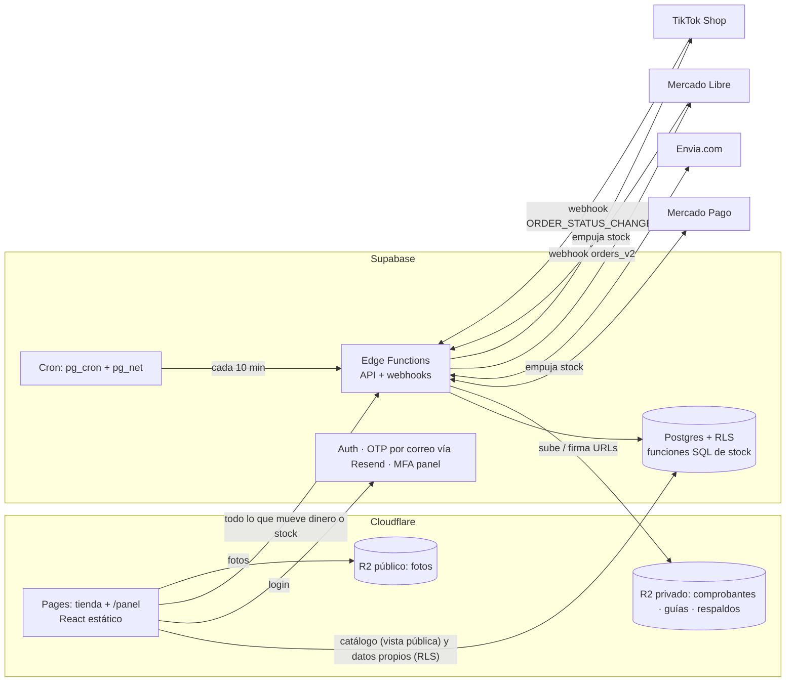
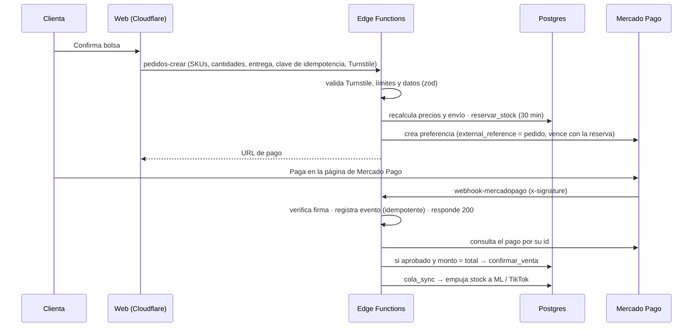

# Pupilentes AGO · Arquitectura y plan por fases

> Documento vivo. Es la guía para que cualquier persona del equipo (con Claude) desarrolle el proyecto real, fase por fase.
> **Cubre el 100% del proyecto:** frontend, backend, base de datos, integraciones, seguridad, pruebas y lanzamiento.
> Repo: `hummingxbi-source/Pupilentes-AGO` · Última actualización: 10 nov 2026 (v2, revisión de seguridad y pagos) · **Estado: Fase 0 por iniciar**
>
> Documentos relacionados: [`README.md`](../README.md) (cómo empezar) · [`docs/FRONTEND.md`](FRONTEND.md) (la demo como punto de partida del diseño).

---

## 0. Cómo trabajamos

### 0.1 Ramas (regla principal)

| Rama | Para qué | Cómo se toca |
|---|---|---|
| **`demo`** | **Copia congelada de la demo** que vio la clienta (incluye el chatbot). Es la referencia de "lo que ideamos". | No se modifica |
| **`main`** | **El proyecto real.** Siempre debe compilar, pasar el CI y funcionar en local. | Solo con PR y CI en verde |
| `fase/N-nombre` | Trabajo de una fase o tarea. Sale de `main` y regresa a `main` con PR. | Push libre; cada push corre el CI |

- La demo también queda marcada con el tag **`demo-v1`** (mismo commit que la rama `demo`).
- **El trabajo no se reparte por integrante en este documento.** Aquí solo están las fases y lo que se hace en cada una; quién toma cada tarea se acuerda al iniciar la fase.
- **Se trabaja y se prueba en local** (frontend + Supabase local). No hay nada publicado del proyecto nuevo hasta que se decida desplegar.
- **Cada push corre las pruebas automáticas** (§7.1). Un PR no se une a `main` con el CI en rojo, y una fase no se cierra con el CI en rojo.
- Para recuperar algo de la demo, por ejemplo el chatbot: `git checkout demo -- src/chat` o abrir la rama `demo`.
- Para pedirle algo a Claude: "Trabajemos la Fase N de `docs/ARQUITECTURA.md`".
- Al cerrar una tarea se marca su casilla; al cerrar una fase se actualiza el **Estado** de arriba y el **Registro de cambios** (§10).
- **⚠️** = decisión pendiente; no se construye hasta decidirla. Todas están reunidas en §9.1.

### 0.2 ¿Qué pasa con la demo en Vercel? (decidido)
**Se desconecta el repo de Vercel; no se borra nada.** En Vercel: proyecto → *Settings* → *Git* → *Disconnect*.
- El link que tiene la clienta **sigue funcionando** con la demo tal cual está, pero ya no se actualiza con los cambios del repo.
- **Hay que desconectarlo antes de subir código a `main`.** Mientras siga conectado, cada push a `main` se publica en el link de la clienta.
- Más adelante, cuando el proyecto nuevo se despliegue en Cloudflare, se borra el proyecto de Vercel. El plan Hobby de Vercel es solo para uso personal no comercial [4], así que no se usa para producción.

### 0.3 Visibilidad del repo (⚠️ D1)
Hoy el repo es **público**. Con pagos de por medio hay que decidirlo a propósito:

| | Público | Privado |
|---|---|---|
| Ramas protegidas (PR obligatorio, CI obligatorio) | Disponibles en GitHub Free [30] | **No disponibles en GitHub Free**; requieren Pro o Team [30] |
| Código, reglas de negocio y pruebas de seguridad | Visibles para cualquiera | Solo el equipo |
| Un secreto subido por error | Queda expuesto al instante | Queda dentro del equipo (igual se rota) |
| Logs del CI | Públicos | Privados |

**Recomendación: privado**, porque es el producto comercial de una clienta y un secreto filtrado sería público al instante. El costo es que "solo con PR" deja de estar forzado por GitHub y pasa a ser regla del equipo, respaldada por el CI en cada push. Si se prefiere que GitHub lo fuerce, las opciones son dejarlo público o pagar GitHub Team.
En ambos casos: nunca se usa el disparador `pull_request_target`, y los secretos del CI son solo de *sandbox*.

---

## 1. Alcance

**Proyecto real = funcionalidades de la demo hechas reales + Mercado Pago + sincronización de stock con Mercado Libre y TikTok Shop.**

| Módulo | En la demo | En el proyecto real |
|---|---|---|
| Landing, catálogo por familias, filtro de graduación | Datos fijos en código | Lee de la BD |
| Test de tono, probador/lookbook con cámara | Solo frontend | Se conserva |
| Bolsa y checkout (Metro / DiDi / paquetería) | Cotizador simulado | **Envia.com** real + Metro/DiDi con agenda |
| Pago por transferencia con comprobante | Simulado | Real, aprobado desde el panel |
| **Pago con Mercado Pago** | — | **Nuevo** (Checkout Pro) |
| Rastreo de pedido | Simulado | Real (enlace con token, o folio + teléfono) |
| Cuenta de clienta con puntos | Simulado | Login con **código por correo** (gratis) + puntos reales |
| Panel: Hoy · Pedidos · Inventario (Excel) · Catálogo · Clientas | `localStorage`, sin login | BD real, login con MFA |
| **Sincronización de stock con ML y TikTok** | — | **Nuevo** |
| Chatbot | Existe | **Fuera de alcance** (fase futura). Se oculta con `VITE_CHATBOT=false`; el código se conserva. |
| Aviso de privacidad / términos | — | Publicado antes de recibir el primer dato real (Fase 9) |

**Lo que vimos en sus canales (capturas, 8 nov 2026):**
- ML: Urban Layer (líneas Cloud, Olivia, Siri, Maldives, Angeles N, Cleopatra, Gemini, Chelsea, Alaska, Memphis, Gogh N, Orlando, Las Vegas…) a $799; Freshlady $299–$310; accesorios (solución Renu $129, estuches $139–$179, kit de estuches, gafas $149). Sin graduación visible. Envío con logística de ML.
- Publicaciones mezcladas: por línea con colores como variantes y por color suelto. Un producto físico puede estar en varias publicaciones.
- TikTok: por **duración** (trimestral $289, semestral, anual $590) y por **diseño** (Halloween, "14 opciones"). Envío de TikTok.

**Reglas de negocio:** se vende **siempre por par** (1 unidad = 1 caja, misma graduación en ambos ojos). La clienta tiene fotos por graduación en un Drive, pero **no dependemos de él para avanzar**. Pagos web: transferencia + Mercado Pago. **Se puede comprar sin crear cuenta** (compra como invitada); la cuenta solo sirve para puntos e historial (⚠️ D5).

---

## 2. Infraestructura

**Resumen: frontend y archivos en Cloudflare; backend y base de datos en Supabase.**

| Pieza | Elección | Por qué | Costo |
|---|---|---|---|
| Frontend | **Cloudflare Pages** (Vite + React actual) | Mismo esquema que JM Nutrólogo | $0 · ancho de banda ilimitado, 500 builds/mes [3] |
| Backend (API y webhooks) | **Supabase Edge Functions** (Deno/TypeScript) | Todo el backend junto a la BD | $0 · 500,000 invocaciones/mes en Free [9] |
| Tareas programadas | **Supabase Cron** (`pg_cron` + `pg_net` llamando a una Edge Function) | Viene incluido; los secretos se guardan en Vault [20] | $0 |
| BD + Auth | **Supabase** (Postgres + RLS + Auth) | Ya lo usan | 2.º proyecto Free (§2.2) |
| Archivos (fotos, comprobantes, guías PDF) | **Cloudflare R2**, **nunca** Supabase Storage | Supabase Free da solo 1 GB de archivos [9] | $0 hasta 10 GB/mes; salida gratis [5] |
| Respaldos de BD | **GitHub Actions** programado (`supabase db dump` → **cifrado** → R2) | Las Edge Functions no pueden correr `pg_dump` | $0 dentro de los minutos gratis de GitHub |
| Pagos web | **Mercado Pago Checkout Pro** + transferencia | Ya tiene cuenta MP por ML; tarjeta, SPEI, OXXO, meses sin tarjeta [7]. La tarjeta se captura en la página de Mercado Pago, nunca en la nuestra | 3.49% + $4 MXN + IVA por cobro con dinero al instante [8][36] (confirmar en la página oficial antes de cotizar) |
| Envíos web | **Envia.com** | Sin mensualidad [15]; API con sandbox, guías PDF, rastreo y webhooks [16] | Guía (la paga la clienta en el checkout) |
| Correos (login y avisos) | **Resend** como SMTP de Supabase Auth | El SMTP propio de Supabase solo manda 4 correos/hora [17] | $0: 100/día, 3,000/mes [18] |
| Anti-bots | **Cloudflare Turnstile**, validado en el servidor | Checkout, rastreo, subida de comprobante y login | $0 |
| Dominio | **Cloudflare Registrar** | Precio de mayoreo, sin margen [6] | Costo del registro |

**¿Por qué Envia.com y no Skydropx?** Ninguno cobra mensualidad: Envia.com dice "paga sólo por lo que envíes, sin mensualidades" [15], y Skydropx cobra por envío, sin contratos ni mínimos [19]. Pero Envia.com publica su API con ambiente de pruebas (`api-test.envia.com`) y webhooks de rastreo [16]; de Skydropx no encontramos documentación pública de API.

**¿Por qué login por correo?** Es gratis (Supabase + Resend). WhatsApp y SMS cobran por mensaje. Límite: 100 correos al día en Resend gratis [18]. Resend necesita el **dominio de la clienta verificado**; en desarrollo, Supabase local captura los correos sin enviarlos.

### 2.1 Límites de las Edge Functions [21]
- **2 s de CPU por petición** (esperar red o BD no cuenta).
- **150 s** máximo de vida por instancia en Free (400 s en Pro).
- 256 MB de memoria; hasta 100 funciones por proyecto en Free.
- Para responder rápido a un webhook y procesar después: `EdgeRuntime.waitUntil(promesa)`. La instancia sigue viva hasta terminar la promesa, dentro de esos límites [22].
- Los webhooks externos (ML, TikTok, MP, Envia) no traen sesión de Supabase. Esas funciones se despliegan con `verify_jwt = false` y **validan su propia firma**.
- **Pasar la verificación de la plataforma no autentica a nadie** [25]: cada función decide en su código quién puede llamarla (§6.2).

### 2.2 Supabase: plan y almacenamiento (⚠️ decisión final antes del lanzamiento)
Datos [9]:
- **Free:** 2 proyectos activos; se pausan tras 1 semana sin actividad; **500 MB de BD, 1 GB de archivos**, 5 GB de salida. Sin respaldos automáticos (por eso el respaldo propio).
- **Pro:** $25 USD/mes por organización con $10 de crédito (cubre 1 proyecto Micro); cada proyecto extra suma ~$10/mes; 8 GB de BD y 100 GB de archivos; respaldos diarios de 7 días.

**El problema de JM Nutrólogo:** se llena en 2.5–3 meses porque los PDFs e imágenes van en Supabase Storage (1 GB).

**Propuesta (aplica a JM y a AGO):**
1. **Archivos en R2, no en Supabase.** R2 da 10 GB gratis con salida gratis [5]. Al ritmo de JM (≈1 GB cada 2.5–3 meses), alcanza para ≈25–30 meses; después cada GB cuesta $0.015 USD/mes [5]. Supabase solo guarda la URL.
2. **Comprimir al subir:** imágenes a WebP en el navegador, con tamaño máximo.
3. **AGO en el 2.º proyecto Free.** Sin archivos dentro, 500 MB de filas alcanzan para mucho. Se monitorea el tamaño.
4. **Pausa por inactividad:** Supabase cuenta como actividad abrir el panel o recibir "peticiones reales de la app", y dice que unas cuantas al día suelen bastar, sin garantizarlo; no menciona los crons [31]. Una tienda abierta con visitas genera esas peticiones (cada visita lee el catálogo). ⚠️ En la Fase 0 se verifica en la práctica y, antes del lanzamiento, se vigila el correo de aviso que Supabase manda una semana antes de pausar [31].
5. **Pasar a Pro** con una 3.ª clienta con BD, o si una BD pasa ~400 MB. Con $3,000 MXN/año por clienta, Pro se paga solo a partir de **~5 clientas** (dólar a $18.79 [10]: costo ≈ 3,382 + 2,255·n MXN/año contra ingreso de 3,000·n).
6. ⚠️ **R2 es por cuenta de Cloudflare:** si JM y AGO comparten cuenta, comparten los 10 GB gratis.

### 2.3 Llaves de Supabase (decidido)
Se usan desde el día 1 las llaves nuevas: **`sb_publishable_…`** en el navegador y **`sb_secret_…`** en las Edge Functions. Supabase planea retirar las llaves antiguas `anon` y `service_role` a finales de 2026 [25], así que no se construye sobre ellas. La llave secreta devuelve 401 si se usa desde un navegador [25]. En las funciones se lee de `SUPABASE_SECRET_KEYS` [25].

### 2.4 Archivos en R2: reglas (decidido)
- **Fotos de catálogo:** bucket público servido por un **dominio propio** (p. ej. `img.dominio.mx`). La dirección `r2.dev` tiene límite de peticiones y es solo para desarrollo [29]; con dominio propio se activa la caché de Cloudflare [29]. Nombres con hash y `Cache-Control: public, max-age=31536000, immutable`.
- **Comprobantes y guías:** bucket **privado**. Se ven solo con URL firmada de lectura de 5 minutos, generada por una Edge Function tras comprobar el rol.
- **Subidas desde el panel** (dueña con sesión y MFA): URL firmada de `PUT` de 60 s. R2 no admite subidas `POST` con formulario, pero sí permite firmar el `Content-Type`, y rechaza con 403 lo que no coincida [28]. El nombre del archivo lo genera el servidor. Al terminar, la función comprueba tamaño y tipo reales (`HEAD` + primeros bytes) y borra lo que no cumpla.
- **Subidas del público** (comprobante de transferencia): **pasan por la Edge Function `comprobantes-subir`**, no van directo a R2. La función exige el token del pedido y Turnstile, limita a 5 MB, acepta solo jpg/png/webp/pdf verificando los primeros bytes del archivo, y guarda con nombre aleatorio. (Si en la Fase 3 el límite de tamaño de petición de las funciones no alcanza, se usa `PUT` firmado + verificación posterior.)
- Las URL firmadas no funcionan con dominios propios, solo con el endpoint S3 de la cuenta [28].

---

## 3. Arquitectura



**Principio central:** nuestra BD es la única fuente de verdad del stock. La web, Mercado Libre y TikTok son canales.

**Tres niveles de confianza:**
1. **Navegador (no confiable).** Solo tiene la llave publicable. Todo lo que manda se valida de nuevo.
2. **Edge Functions (confiables).** Tienen la llave secreta y los secretos de terceros. Saltan RLS, así que **cada función comprueba identidad, rol y datos por su cuenta**.
3. **Postgres (última barrera).** RLS, permisos por columna y funciones SQL atómicas impiden estados inválidos aunque una función tenga un error.

**Qué va directo a la BD y qué pasa por Edge Functions:**
- **Directo (supabase-js + RLS):** leer el catálogo (vista `catalogo_publico`); la clienta lee sus pedidos y puntos; el panel lee pedidos y clientas y edita el catálogo (nombres, descripciones, precios, fotos).
- **Edge Function (lleva secretos o reglas que no pueden quedar en el navegador):** crear pedido, pagos, reembolsos, envíos, **cualquier cambio de stock**, aprobar transferencias, subir comprobantes, firmar URLs de R2, rastreo público, webhooks, conciliación y todo lo de ML y TikTok.

### 3.1 Estructura de carpetas (objetivo)

```
/src                        Frontend (React) → Cloudflare Pages
  /pages  /panel  /ui
  /chat                     (fuera de alcance; oculto con VITE_CHATBOT=false)
  /lib                      cliente Supabase (llave publicable)
/public
  _headers                  cabeceras de seguridad y CSP (Cloudflare Pages)
/supabase
  config.toml
  /migrations               SQL versionado: tablas, RLS, permisos, funciones de stock, crons
  seed.sql                  catálogo semilla (Fase 1)
  /tests                    pgTAP: RLS, permisos y stock
  /functions                Edge Functions (Deno/TS)
    /_shared                auth.ts (sesión, rol, aal2) cors.ts turnstile.ts limite.ts
                            validar.ts (zod) firmas.ts idempotencia.ts alertas.ts
                            stock.ts precios.ts r2.ts
                            canales/ml.ts canales/tiktok.ts  pagos/mercadopago.ts  envios/envia.ts
    /salud
    /pedidos-crear  /pedidos-rastrear
    /comprobantes-subir
    /panel-stock  /panel-transferencias  /pagos-reembolsar
    /envios-cotizar  /envios-guia
    /r2-firmar
    /webhook-mercadopago  /webhook-mercadolibre  /webhook-tiktok  /webhook-envia
    /cron-conciliar         lo invoca Supabase Cron
/scripts
  importar-catalogo         Excel/CSV + carpeta de fotos → BD + R2
/plantillas
  catalogo.xlsx             plantilla del catálogo
/tests
  /unit  /integracion  /seguridad  /e2e
/.github
  /workflows                ci.yml (cada push) · respaldo.yml (diario) · despliegue.yml (manual)
  dependabot.yml
/docs                       este documento
/api                        (demo, Vercel; se elimina de main en la Fase 0 — sigue en la rama demo)
```

### 3.2 Modelo de datos

Convenciones: dinero en `numeric(10,2)` (nunca decimales flotantes; en TypeScript se opera en centavos enteros); fechas en `timestamptz`; llaves `uuid`.

**Esquema `public` (expuesto por la API de datos, siempre con RLS):**

| Tabla | Campos clave | Notas |
|---|---|---|
| `marcas` | id, nombre | Urban Layer, Freshlady, … |
| `productos` | id, marca_id, nombre (línea/modelo), tipo (`lente`/`accesorio`), familia de color, descripción, activo | "Línea Cloud" |
| `variantes` | id, producto_id, **sku** (único), color/diseño, duración (`trimestral`/`semestral`/`anual`/null), **graduación** (null = neutro), precio, **stock** (pares físicos), **stock_reservado**, activo | Unidad = **par**. Disponible = `stock − stock_reservado`. `stock` y `stock_reservado` **no son editables** por ningún rol de la API (permiso por columna) |
| `imagenes` | id, producto_id, variante_id (null = general), graduación (opcional), url_r2, orden | Fotos por graduación |
| `publicaciones_canal` | id, variante_id, canal (`ml`/`tiktok`), id_externo_item, id_externo_variante, activo, ultimo_sync | **N publicaciones por variante** |
| `movimientos_stock` | id, variante_id, delta, motivo (`venta`/`ajuste`/`devolucion`/`reserva`/`liberacion`/`conciliacion`), canal, pedido_id, **ref_externa (única)**, usuario, creado_en | Bitácora: nunca se edita ni se borra |
| `reservas_stock` | pedido_id, variante_id, cantidad, expira_en, estado (`activa`/`confirmada`/`liberada`) | Una fila por renglón reservado; hace exacta e idempotente la liberación |
| `pedidos` | id, folio, **token_rastreo** (aleatorio, único), **clave_idempotencia** (única), canal, id_externo, estado, pago_estado, clienta_id (null = invitada), **contacto** (nombre, teléfono, correo), subtotal, descuento, puntos_usados, envío, total, entrega (jsonb), expira_reserva_en | El contacto vive en el pedido para permitir compra sin cuenta |
| `pedido_items` | pedido_id, variante_id, cantidad, precio_unitario | Precio congelado |
| `pagos` | pedido_id, proveedor (`mercadopago`/`transferencia`), id_externo, estado, estado_detalle, monto, moneda, comprobante_clave, **único (proveedor, id_externo)** | `comprobante_clave` es el nombre en R2 privado, no una URL |
| `envios` | pedido_id, proveedor, servicio, guía, url_rastreo, estado, costo, etiqueta_clave | |
| `clientas` | id, **auth_user_id** (único, null si aún no tiene cuenta), teléfono, nombre, correo, creado_en | Ya no depende de tener cuenta |
| `puntos_movimientos` | clienta_id, delta, motivo, pedido_id | Saldo = suma; se descuenta con bloqueo de fila |
| `perfiles_panel` | user_id, rol (`duena`/`ayudante`) | Único lugar donde vive el rol. **Nunca** en los metadatos editables del usuario |
| `auditoria_panel` | usuario, acción, tabla, id, antes, después, creado_en | Cambios de precio, aprobaciones de transferencia, reembolsos y ajustes de stock |

**Vista `catalogo_publico`:** lo único que lee el público. Expone solo producto, variante, precio, fotos y `disponible`; nada interno.

**Esquema `privado` (no expuesto por la API; solo lo tocan las Edge Functions):**

| Tabla | Campos clave | Notas |
|---|---|---|
| `eventos_webhook` | proveedor, **id_evento (único)**, payload, recibido_en, procesado_en, intentos, error | Idempotencia. El `payload` se borra a los 90 días |
| `cola_sync` | variante_id, canal, intentos, proximo_intento, error | Bandeja de salida: qué stock falta empujar a ML/TikTok |
| `limites_tasa` | clave (ip / teléfono / folio + acción), ventana, conteo | Límite de peticiones |
| `integraciones` | canal, cuenta_externa, expira_en, id del secreto en Vault | Los tokens OAuth van en **Supabase Vault**, no en la tabla |
| `alertas` | tipo, detalle, creado_en, atendida | Lo que el equipo o la dueña deben revisar |

**Regla de oro del stock.** El stock solo cambia con cuatro funciones SQL, cada una en una sola transacción:

| Función | Qué hace | Cuándo |
|---|---|---|
| `reservar_stock(pedido)` | Por cada renglón: `UPDATE variantes SET stock_reservado = stock_reservado + n WHERE id = … AND stock − stock_reservado >= n`. Si un renglón no alcanza, se revierte todo. Recorre las variantes en orden de id para evitar bloqueos cruzados | Al crear el pedido |
| `confirmar_venta(pedido)` | Baja `stock` y `stock_reservado`, marca la reserva como confirmada, escribe la venta en la bitácora y encola la sincronización | Pago aprobado |
| `liberar_reserva(pedido)` | Devuelve lo reservado; no hace nada si ya estaba liberada o confirmada | Pago vencido, rechazado o pedido cancelado |
| `mover_stock(variante, delta, motivo, ref)` | Inserta en la bitácora (rechaza `ref_externa` repetida), ajusta `stock` sin bajar de 0 y encola la sincronización | Ventas de ML/TikTok, ajustes, devoluciones, conciliación |

- El `UPDATE … WHERE` condicional es lo que evita la sobreventa: dos compras simultáneas de la última pieza se resuelven dentro de Postgres y solo una gana.
- Las cuatro son `SECURITY DEFINER` con `search_path` fijo. En Postgres **toda función es ejecutable por cualquier rol por defecto**, incluido el anónimo [27]; por eso la primera migración hace `ALTER DEFAULT PRIVILEGES … REVOKE EXECUTE ON FUNCTIONS FROM public`, y estas funciones solo se conceden a `service_role`. Una prueba pgTAP lo comprueba.
- A ML y TikTok se publica el **disponible** (`stock − stock_reservado − colchón`), no el stock físico.

### 3.3 Flujos principales

**A. Venta web con Mercado Pago**


Reglas del flujo:
1. **`pedidos-crear` no recibe precios.** Recibe SKUs y cantidades; el precio sale de la BD y el costo de envío se vuelve a cotizar en el servidor. Si el total calculado difiere del que vio la clienta, se le muestra el nuevo antes de pagar.
2. **Clave de idempotencia** generada por el navegador: un doble toque o un reintento de red devuelve el mismo pedido, no crea otro.
3. **Topes anti-acaparamiento:** máximo de piezas por renglón y por pedido, y máximo de pedidos sin pagar por IP y por teléfono. Sin esto, un bot podría reservar todo el inventario sin pagar.
4. **El webhook solo avisa; la verdad se consulta.** Tras verificar la firma, la función pide el pago a la API de Mercado Pago con nuestro token y comprueba: `external_reference` = nuestro pedido, monto = `pedidos.total`, moneda = MXN, estado = `approved`. Solo entonces confirma.
5. **Firma:** HMAC-SHA256 con el secreto de la aplicación sobre `id:<data.id>;request-id:<x-request-id>;ts:<ts>;`, comparado en tiempo constante con el `v1` de la cabecera `x-signature`; si no coincide, 401 [23].
6. **Tiempos:** Mercado Pago espera 200/201 en menos de 22 s y, si no, reintenta cada 15 minutos [23]. Respondemos de inmediato y procesamos con `waitUntil`.
7. **Pago que llega tarde** (la reserva ya venció): se intenta reservar de nuevo. Si hay stock, se confirma. Si no, el pedido queda en `pagado_sin_stock`, se genera una alerta y la dueña lo reembolsa desde el panel (`pagos-reembolsar`).
8. **Contracargos y reembolsos** cambian el pedido a `contracargo` / `reembolsado` y generan alerta. Las alertas de fraude de Mercado Pago no se reintentan si no se responde 200 [23]; se registran y marcan el pedido como "no entregar".
9. **Efectivo y SPEI por Mercado Pago (⚠️ D2).** Mercado Pago recomienda dar al menos 3 días de vigencia a los pagos fuera de línea porque la acreditación puede tardar hasta 2 horas hábiles; la vigencia se fija con `date_of_expiration`, y si el pago llega vencido se devuelve a la cuenta del pagador [24]. Eso obliga a reservar la pieza hasta 3 días. Propuesta: cuando el webhook informa un pago pendiente fuera de línea, la reserva se extiende hasta esa vigencia.

**A2. Venta web por transferencia directa**
1. `pedidos-crear` reserva el stock con una vigencia mayor (⚠️ D3, propuesta: 24 h) y deja el pedido en `pendiente_pago`.
2. La clienta sube su comprobante con `comprobantes-subir` (§2.4) → `pendiente_validacion`.
3. La dueña (sesión con MFA) lo aprueba o rechaza en el panel vía `panel-transferencias`. Aprobar llama a `confirmar_venta`; rechazar o vencer llama a `liberar_reserva`. Ambas quedan en `auditoria_panel`.

**Estados del pedido:** `pendiente_pago → pendiente_validacion (solo transferencia) → pagado → preparando → enviado → entregado`, más `cancelado`, `expirado`, `pagado_sin_stock`, `reembolsado` y `contracargo`. Las transiciones válidas se comprueban en una función SQL; no se cambia el estado con un `UPDATE` libre.

**B. Venta en Mercado Libre:** aviso `orders_v2` → hay que responder **200 en menos de 500 ms**; si no, ML reintenta durante 1 hora y luego lo da por perdido [33] → la función responde antes de hacer cualquier trabajo y sigue con `waitUntil` → comprueba que `user_id` y `application_id` del aviso sean los nuestros [33] y consulta la orden con nuestro token (ML no firma sus avisos; así validamos que sea real) → `mover_stock` (`ref = ml:order:item`) → `cola_sync` empuja el disponible a las otras publicaciones y a TikTok. Los avisos perdidos se recuperan con `missed_feeds` [33] desde el cron.

**C. Venta en TikTok Shop:** `ORDER_STATUS_CHANGE` → validar HMAC-SHA256 y responder en menos de 3 s [12] → TikTok puede duplicar avisos y reintenta 4 veces antes de perderlos [12] → deduplicar por `tts_notification_id` → igual que ML.

**D. Cron (cada 10 min):** toma un candado (`pg_advisory_lock`) para no encimarse con la corrida anterior; libera reservas vencidas; procesa `cola_sync` y reintenta eventos fallidos; recupera órdenes de ML (`missed_feeds`) y TikTok sin webhook; compara el stock publicado contra el nuestro y corrige; borra `payload` viejos. La función exige un secreto guardado en Vault [20].

**E. Cancelación / devolución:** `mover_stock(+n, 'devolucion')`, solo si la dueña confirma en el panel que el producto regresó vendible.

**F. Rastreo público:** el enlace del mensaje de confirmación lleva `token_rastreo` (imposible de adivinar) y abre el pedido directo. Sin enlace, `pedidos-rastrear` pide folio + últimos 4 dígitos del teléfono + Turnstile, con un máximo de 5 intentos por folio por hora (4 dígitos son solo 10,000 combinaciones y el folio es consecutivo, así que sin ese tope se podría adivinar). Muestra estado y guía, nunca el domicilio completo.

### 3.4 Rendimiento
- **Catálogo:** una sola consulta a la vista `catalogo_publico`, guardada en caché en el navegador (se muestra lo guardado y se refresca en segundo plano). El disponible se vuelve a comprobar en el servidor al crear el pedido, así que la caché nunca causa sobreventa.
- **Imágenes:** WebP en 2–3 anchos, con `srcset`, desde R2 con dominio propio y caché de Cloudflare (§2.4).
- **Código:** las rutas ya se cargan por separado (`lazy` en `App.jsx`), y `xlsx` y `jspdf` solo al usarlos. Se conserva así; el modelo de MediaPipe (3.7 MB) solo se descarga al abrir el probador.
- **Backend:** la lógica de stock vive en funciones SQL para que cada operación sea un solo viaje a la BD. Índices en `variantes(sku)`, `pedidos(folio)`, `pedidos(token_rastreo)`, `publicaciones_canal(canal, id_externo_item, id_externo_variante)` y `reservas_stock(expira_en)`.
- **Región de Supabase:** la disponible más cercana a México (se elige al crear el proyecto; no se puede cambiar después sin migrar).
- **Meta (Fase 8):** LCP menor a 2.5 s en móvil con red 4G en landing y tienda, medido con Lighthouse.

---

## 4. Ambientes

| | Desarrollo (donde se trabaja) | Preview (opcional, desde la Fase 0) | Producción (al lanzar) |
|---|---|---|---|
| Frontend | `npm run dev` | Cloudflare Pages preview | Cloudflare Pages (`main`) |
| Backend + BD | **Supabase local** (`supabase start` + `supabase functions serve`) | **Antes del lanzamiento:** el proyecto Supabase de AGO hace de *staging* (aún no hay datos reales). **Después:** modo demo con datos falsos; la integración se prueba en local | Proyecto Supabase de AGO |
| Pagos | MP sandbox | MP sandbox | MP real |
| Envíos | `api-test.envia.com` [16] | `api-test.envia.com` | Envia.com real |
| Correos | Capturados localmente | Resend (pruebas) | Resend |

- **Webhooks en local:** Mercado Pago, ML y TikTok necesitan una URL pública. Se usa un túnel (`cloudflared tunnel`) hacia `supabase functions serve`, o se prueban contra el *staging*.
- **De staging a producción (Fase 9):** se reinicia la BD del proyecto, se **rotan todas las llaves y secretos**, se cambian credenciales de sandbox por las reales y se aplican migraciones desde el flujo de despliegue, nunca a mano.
- Los secretos de producción viven solo en Supabase (*secrets* y Vault) y en GitHub (*secrets* de respaldo y despliegue). Nadie los guarda en su computadora.

---

## 5. Fases

> Los trámites externos (app de ML, Partner de TikTok, cuentas de Envia.com y MP) **se inician en la Fase 0** porque tardan; la revisión del vendedor de prueba de TikTok puede tardar de 3 a 7 días hábiles [13]. **Ninguna fase depende del Drive** de la clienta.
> Toda fase termina con: checklist manual hecho, pruebas automáticas de la fase agregadas y **CI en verde**.

### Fase 0 · Cimientos
**Objetivo:** el repo listo para trabajar en equipo, todo corriendo en local, el esqueleto del backend y el CI funcionando.
- [x] Rama `demo` + tag `demo-v1` con la demo congelada; `main` para el proyecto real.
- [ ] **Desconectar el repo de Vercel** (§0.2). Va antes de cualquier cambio de código en `main`.
- [ ] ⚠️ D1: decidir visibilidad del repo (§0.3) y aplicar la protección de ramas que corresponda.
- [ ] En `main`: chatbot oculto (`VITE_CHATBOT=false`); quitar la carpeta `api/` de Vercel y el plugin `apiLocal` de `vite.config.js` (siguen en la rama `demo`).
- [ ] **Dependencias al día.** `npm audit` reporta hoy 7 vulnerabilidades (1 crítica, 3 altas, 3 moderadas): actualizar `jspdf` (crítica; arrastra `dompurify`), `vite` y `react-router-dom`; y **reemplazar `xlsx` de npm**, que no tiene arreglo ahí: la versión corregida (0.19.3 o posterior) solo se publica en el CDN de SheetJS [32].
- [ ] `HashRouter` → `BrowserRouter` y `base: '/'` en Vite. Cloudflare Pages sirve la raíz para cualquier ruta que no sea un archivo cuando no hay `404.html` [35]. Se hace ahora porque las URL de regreso de Mercado Pago y el enlace de rastreo necesitan rutas normales.
- [ ] `public/_headers` con cabeceras base: `X-Content-Type-Options`, `X-Frame-Options`, `Referrer-Policy`, `Permissions-Policy` (cámara solo para el propio sitio), HSTS y CSP en modo solo-reporte.
- [ ] Supabase CLI local + `supabase/config.toml` + primera migración: esquema `privado`, `ALTER DEFAULT PRIVILEGES` que quita `EXECUTE` a `public` [27]; `supabase start` funciona.
- [ ] `_shared`: `auth.ts`, `cors.ts` (solo el origen de la tienda), `turnstile.ts`, `limite.ts`, `validar.ts`.
- [ ] Edge Function de prueba (`salud`) corriendo con `supabase functions serve` y llamada desde el frontend local.
- [ ] Proyecto **Supabase** en la nube (2.º Free), en la región más cercana, con las llaves nuevas (§2.3), vinculado pero sin datos reales.
- [ ] Proyecto en **Cloudflare Pages** conectado a `main` (opcional hasta querer compartir un preview).
- [ ] Supabase Cron llamando a `cron-conciliar` (vacía) cada 10 min, con secreto en Vault.
- [ ] Buckets **R2**: público para fotos de catálogo, privado para comprobantes y guías, privado aparte para respaldos.
- [ ] Estructura de carpetas de §3.1 y `.env.example` actualizado (hoy todavía describe Vercel y el chatbot).
- [ ] Alinear `CLAUDE.md`, `README.md` y `docs/FRONTEND.md` con esta v2 (funciones de stock, llaves nuevas, rutas sin `#`, CI en cada push).
- [ ] **CI en cada push** (§7.1): trabajos `calidad` y `seguridad` desde ya; `bd` en cuanto exista la primera migración. Dependabot activado.
- [ ] Respaldo diario de la BD a R2, **cifrado** (§6.1, regla 13).
- [ ] **Iniciar trámites:** app de desarrolladores de ML, Partner de TikTok Shop, cuenta Envia.com (sandbox) y credenciales de prueba de Mercado Pago.

**Probar a mano:** cualquiera del equipo clona el repo, sigue el `README.md` y levanta frontend + Supabase local; el frontend llama a la Edge Function `salud`; recargar una ruta interna (p. ej. `/tienda`) no da 404.
**Terminado cuando:** Vercel está desconectado, `npm audit` no reporta altas ni críticas, el CI pasa en cada push y `main` tiene el esqueleto completo.

### Fase 1 · Base de datos y catálogo semilla (sin Drive)
**Objetivo:** la tienda lee de la BD con un catálogo de trabajo realista.
- [ ] Migraciones de §3.2 con **RLS en todas las tablas** de `public` y permisos por columna en `variantes`.
- [ ] Vista `catalogo_publico` (única lectura del público).
- [ ] Funciones `reservar_stock`, `confirmar_venta`, `liberar_reserva` y `mover_stock` + pruebas pgTAP.
- [ ] **Catálogo semilla** (`seed.sql`) con lo visto en ML y TikTok: marcas, líneas, colores, duraciones, precios y accesorios. Imágenes de la demo como provisionales; graduaciones de ejemplo (−0.50 a −8.00).
- [ ] Plantilla `plantillas/catalogo.xlsx` + `scripts/importar-catalogo` (Excel/CSV + fotos → BD + R2, fotos a WebP), probado con el semilla.
- [ ] Frontend: tienda, ficha y filtros leen de la vista, con caché en el navegador (§3.4). Selector: color/diseño → duración → graduación (o "sin graduación"). Siempre por par.
- [ ] Accesorios como productos simples.

**Probar a mano:** navegar el catálogo, filtrar por graduación, ver agotados y fotos por graduación.
**Automáticas:** pgTAP: el anónimo no lee pedidos ni clientas; el anónimo y un usuario con sesión **no pueden ejecutar** las funciones de stock ni hacer `UPDATE` de `stock`; `mover_stock` no baja de 0 y rechaza `ref` repetida; dos reservas simultáneas de la última pieza → solo una pasa; liberar dos veces no duplica. Unitarias del importador.
**Terminado cuando:** la tienda funciona completa con el catálogo semilla, el importador carga la plantilla sin errores y el CI está en verde.

### Fase 2 · Panel seguro e inventario
- [ ] Login de panel (Supabase Auth, correo + contraseña) con **MFA (TOTP)**; roles `duena`/`ayudante` en `perfiles_panel`. Las cuentas de panel las crea el equipo; no hay registro abierto al panel.
- [ ] **MFA forzado en la BD y en las funciones**, no solo en la pantalla: políticas RLS restrictivas que exigen `aal2` en las tablas del panel [26], y `auth.ts` rechaza sesiones de panel sin `aal2`.
- [ ] Segunda cuenta de administración con MFA para recuperación (si la dueña pierde su teléfono) (⚠️ D4).
- [ ] Inventario: ajustes con motivo (Edge Function `panel-stock` → `mover_stock`), historial por variante, alertas de stock bajo.
- [ ] Importar/exportar Excel contra la BD con vista previa antes de aplicar.
- [ ] Catálogo: alta y edición de productos, variantes e imágenes (subida a R2 según §2.4, compresión a WebP).
- [ ] `auditoria_panel` registrando cambios de precio y ajustes.
- [ ] Vistas Hoy, Pedidos y Clientas conectadas a la BD. Cierre de sesión por inactividad.

**Probar a mano:** entrar con MFA, ajustar stock, importar un Excel con errores (avisa sin aplicar), subir una foto.
**Automáticas:** sin sesión → 401; sesión con contraseña pero sin MFA → sin datos y 403; `ayudante` intentando borrar o ajustar stock → 403; una clienta con sesión (OTP) no lee ni una fila del panel; Excel malformado no toca la BD; subir un archivo que no es imagen → se rechaza y se borra.
**Terminado cuando:** la dueña podría operar sin su Excel y el CI está en verde.

### Fase 3 · Pedidos y pagos (Mercado Pago + transferencia)
- [ ] `pedidos-crear` según §3.3 A: precios y envío en servidor, zod, Turnstile, clave de idempotencia, topes anti-acaparamiento, `reservar_stock`.
- [ ] Mercado Pago Checkout Pro: preferencia con `external_reference`, vencimiento, URL de regreso y `notification_url`.
- [ ] `webhook-mercadopago`: firma [23], idempotencia, consulta del pago, comprobación de monto y moneda, `confirmar_venta`.
- [ ] Pago tardío → `pagado_sin_stock`; `pagos-reembolsar` desde el panel (rol `duena`).
- [ ] Contracargos, reembolsos y alertas de fraude reflejados en el pedido.
- [ ] Transferencia según §3.3 A2: `comprobantes-subir` y `panel-transferencias`.
- [ ] Máquina de estados del pedido en SQL.
- [ ] Rastreo público según §3.3 F (`pedidos-rastrear`).
- [ ] **Alertas mínimas** (tabla `alertas` + correo al equipo + aviso en "Hoy"): webhook fallido 3 veces, `pagado_sin_stock`, contracargo, cron sin correr.
- [ ] CSP en modo estricto (§6.1, regla 10), ya con Mercado Pago y Turnstile en la lista.
- [ ] ⚠️ D2 (efectivo/SPEI por MP) y D3 (vigencia de la reserva por transferencia) resueltas antes de construir.
- [ ] Mensajes de WhatsApp prellenados del panel conectados a pedidos reales.

**Probar a mano:** compra con tarjeta de prueba; con OXXO de prueba (si aplica); por transferencia aprobada y rechazada; pago abandonado (se libera la reserva); doble toque en "pagar" (un solo pedido); dos compras simultáneas de la última pieza (solo una pasa); pagar después de vencida la reserva.
**Automáticas:** todos los casos de §6.3 marcados como Fase 3.
**Terminado cuando:** 10 compras de prueba seguidas sin descuadre entre pedidos, pagos y stock, y el CI está en verde.

### Fase 4 · Envíos (Envia.com)
- [ ] `envios-cotizar` por CP en el checkout; la clienta elige paquetería y paga el envío. `pedidos-crear` vuelve a cotizar en el servidor.
- [ ] `envios-guia` desde el panel → PDF a R2 privado + rastreo en el pedido.
- [ ] `webhook-envia` → estado del pedido. Se autentica con un secreto en la URL y se confirma el estado consultando la API de Envia.
- [ ] Metro y DiDi: agenda de entregas en el panel.

**Probar a mano:** cotizar a 3 CP; generar guía en sandbox; ver el rastreo.
**Automáticas:** CP inválido → error claro; API caída → mensaje amable y error registrado; costo de envío alterado en el navegador → se cobra el del servidor; webhook de Envia sin secreto → 401.
**Terminado cuando:** un envío real llega con guía generada desde el panel.

### Fase 5 · Mercado Libre
- [ ] OAuth con la cuenta de la clienta; tokens en **Vault** con refresco automático y alerta si falla.
- [ ] Pantalla para **vincular publicaciones ↔ variantes** (varias por variante).
- [ ] `webhook-mercadolibre` (respuesta en menos de 500 ms [33]) → `mover_stock`; empuje del disponible a ML vía `cola_sync`; conciliación y `missed_feeds` en `cron-conciliar`.
- [ ] ⚠️ Confirmar si usa **Full** (bodega de ML): ese stock se maneja aparte.

**Probar a mano:** una compra real barata en ML baja el stock en el panel y en las otras publicaciones; un ajuste en el panel cambia el stock en ML.
**Automáticas:** evento duplicado → un descuento; evento con `user_id` o `application_id` ajenos → ignorado; webhook perdido → la conciliación lo recupera.
**Terminado cuando:** una semana sin descuadres entre ML y la BD.

### Fase 6 · TikTok Shop
- [ ] App en Partner Center (iniciada en la Fase 0) y autorización de la **titular** de la tienda.
- [ ] `webhook-tiktok` con HMAC, respuesta < 3 s y `waitUntil`.
- [ ] Vinculación de SKUs, empuje de inventario y conciliación.

**Automáticas:** firma inválida → 401; mismo `tts_notification_id` → un descuento.
**Terminado cuando:** una semana sin descuadres en los 3 canales.

### Fase 7 · Cuenta de clienta y puntos
- [ ] Login con **código por correo** (Supabase Auth OTP + Resend). Gratis hasta 100 correos/día [18].
- [ ] Protección anti-bots de Supabase Auth con Turnstile. La documentación la confirma para inicio de sesión, registro y recuperación de contraseña [34]; ⚠️ comprobar en esta fase que también cubre el envío de códigos y, si no, envolver el envío en una Edge Function con Turnstile.
- [ ] Al crear la cuenta, los pedidos hechos como invitada con ese mismo correo (ya verificado por el código) se asocian a la clienta.
- [ ] Puntos como bitácora: se ganan al pagarse un pedido y se usan en el checkout (validado en servidor, con bloqueo de fila).
- [ ] Historial de pedidos y guías; recompra en 1 clic.

**Automáticas:** una clienta no ve datos de otra (RLS); no se usan más puntos de los disponibles ni dos veces en paralelo; límite de envío de códigos.

### Fase 8 · Endurecimiento y pruebas E2E automáticas
- [ ] Suite **Playwright** (§7.2) en CI contra el entorno local o un preview.
- [ ] Escaneo OWASP ZAP *baseline* contra el preview.
- [ ] Revisión completa de RLS y permisos: cada tabla, cada función, con la llave publicable y con una sesión de clienta. Revisar los avisos de seguridad del panel de Supabase.
- [ ] Lighthouse en móvil contra la meta de §3.4.
- [ ] Alertas completas: webhooks, conciliación, respaldo, tokens por vencer, tamaño de BD.
- [ ] **Prueba de restauración del respaldo** (descifrar y levantar en local).

### Fase 9 · Lanzamiento
- [ ] Catálogo real cargado (tarea paralela C).
- [ ] Dominio (Cloudflare Registrar), DNS, HTTPS, dominio de imágenes para R2 (§2.4), dominio verificado en Resend.
- [ ] De staging a producción según §4: BD reiniciada, llaves y secretos rotados, credenciales reales de MP y Envia.
- [ ] SEO: metadatos y sitemap.
- [ ] Analítica sin cookies (Cloudflare Web Analytics).
- [ ] **Aviso de privacidad y términos publicados antes del primer dato real.** ⚠️ Validar con un asesor si guardar graduaciones cuenta como dato sensible y si vender lentes graduados tiene requisitos especiales (§8).
- [ ] ⚠️ Decisión final de §2.2 (Supabase Free o Pro).
- [ ] Despliegue de `main` a producción con `despliegue.yml` (Cloudflare Pages + migraciones + funciones) y **borrar el proyecto de Vercel**. Avisar a la clienta del link nuevo.
- [ ] Primera compra real de bajo monto por cada método de pago, y su reembolso.
- [ ] Manual corto para la clienta (incluye qué hacer ante una alerta y cómo recuperar su MFA).

### Tareas paralelas (no bloquean)
- **A. Trámites externos** (desde la Fase 0): ML, TikTok, Envia.com, Mercado Pago.
- **B. Respuestas de la clienta** (§9).
- **C. Catálogo real:** cuando llegue el Drive se pasa a la plantilla y se corre `importar-catalogo`.

### Fuera de alcance (fase futura)
- Chatbot: completo y funcionando en la rama `demo` (`src/chat`, `src/lib/chatbot-kb.js`, `api/`). Para retomarlo, se trae de ahí.

---

## 6. Seguridad

### 6.1 Reglas desde el día 1
1. **Los datos de tarjeta nunca tocan nuestro sistema.** Checkout Pro cobra en la página de Mercado Pago; nosotros solo guardamos el id del pago, su estado y el monto.
2. **RLS en todas las tablas** de `public`. Las tablas internas viven en el esquema `privado`, que la API no expone. El navegador solo usa la llave publicable; la secreta vive solo en los *secrets* de Supabase (§2.3).
3. **Nunca confiar en el navegador:** precios, totales, envío, descuentos, puntos y stock se calculan en el servidor.
4. **Funciones SQL cerradas por defecto:** sin `EXECUTE` para `public`, `anon` ni `authenticated` salvo las que se concedan a propósito [27]. `SECURITY DEFINER` siempre con `search_path` fijo.
5. **Validación de entrada** con zod en cada función, con límites de tamaño y de cantidades.
6. **Webhooks** (`verify_jwt = false`): verificar firma (MP `x-signature` [23], TikTok HMAC-SHA256); ML se valida por `user_id`/`application_id` y consultando su API [33]; **idempotencia** por id de evento; el contenido del aviso nunca se toma como verdad, se consulta al proveedor.
7. **Límites y anti-bots:** límite de peticiones en funciones públicas (`limites_tasa`), Turnstile validado en el servidor, topes anti-acaparamiento en `pedidos-crear` y límites de Auth para el envío de códigos.
8. **CORS:** las funciones que llama el navegador solo aceptan el origen de la tienda. Los webhooks no responden a navegadores.
9. **Secretos** fuera del repo; tokens OAuth en **Vault**; secretos del cron en Vault [20]; gitleaks en cada push; rotación al pasar a producción y cuando alguien deja el equipo.
10. **Cabeceras** (`_headers` en Pages): CSP estricta desde la Fase 3 (scripts solo propios y de Turnstile, `wasm-unsafe-eval` para MediaPipe, conexiones solo a Supabase y R2, sin `unsafe-inline` en scripts), `X-Frame-Options`, `Referrer-Policy`, `Permissions-Policy`, HSTS.
11. **Panel:** MFA forzado con políticas `aal2` en la BD [26] y en las funciones; roles en `perfiles_panel`; cierre por inactividad; bitácora en `auditoria_panel`.
12. **Archivos** según §2.4: el público no sube directo a R2; tipos y tamaño verificados en servidor; privados solo con URL firmada corta.
13. **Respaldos:** diarios, **cifrados con `age`** antes de subir (contienen datos personales), en un bucket privado propio, con una credencial de R2 que solo puede escribir ahí; se conservan 30 días; restauración probada en la Fase 8.
14. **Datos personales mínimos:** de ML y TikTok solo se guarda lo necesario para el stock (id de orden y renglones). Los `payload` de webhooks se borran a los 90 días. **Logs sin datos personales** ni tokens.
15. **Dependencias:** `npm audit` (altas y críticas rompen el CI) + Dependabot; `npm ci` con `package-lock.json`; importaciones de Deno con versión fija.
16. **CI seguro:** permisos mínimos (`contents: read`), acciones fijadas por versión, nunca `pull_request_target`, solo secretos de sandbox; producción se despliega con un flujo manual aparte.

### 6.2 Quién puede llamar a cada función

| Función | Quién | Cómo se comprueba |
|---|---|---|
| `salud` | Cualquiera | — |
| `pedidos-crear`, `envios-cotizar` | Público | Turnstile + límite + zod |
| `pedidos-rastrear` | Público | Token, o folio + 4 dígitos + Turnstile + límite por folio |
| `comprobantes-subir` | Público con token del pedido | Token + Turnstile + límite + tipo y tamaño |
| `panel-stock`, `pagos-reembolsar`, `panel-transferencias` | `duena` | Sesión válida + `aal2` + rol |
| `envios-guia`, `r2-firmar` | `duena` o `ayudante` | Sesión válida + `aal2` + rol |
| `webhook-*` | El proveedor | Firma o secreto + idempotencia + consulta al proveedor |
| `cron-conciliar` | Supabase Cron | Secreto de Vault en la cabecera |

### 6.3 Pruebas de seguridad automatizadas (`tests/seguridad` y pgTAP)
| Ataque | Esperado | Desde |
|---|---|---|
| Leer `pedidos`/`clientas` con la llave publicable | 0 filas / error | Fase 1 |
| Ejecutar `mover_stock` o `reservar_stock` por RPC como anónimo o con sesión | Permiso denegado | Fase 1 |
| `UPDATE` de `stock` directo desde el panel | Permiso denegado | Fase 1 |
| Leer cualquier tabla del esquema `privado` por la API | No existe para la API | Fase 1 |
| Funciones de panel sin sesión / `ayudante` en acción de dueña | 401 / 403 | Fase 2 |
| Sesión de panel con contraseña pero sin MFA | Sin datos, 403 | Fase 2 |
| Clienta con sesión intentando leer el panel | 0 filas, 403 | Fase 2 |
| Subir `.html`/`.svg` renombrado a `.jpg`, o 50 MB | Rechazado | Fase 2–3 |
| `pedidos-crear` con precio, total o envío alterados | Se cobra lo del servidor | Fase 3–4 |
| `pedidos-crear` repetido con la misma clave | Un solo pedido | Fase 3 |
| Cantidad negativa, cero o enorme | Rechazado | Fase 3 |
| 20 pedidos sin pagar desde la misma IP | Bloqueado; el stock no queda acaparado | Fase 3 |
| Webhook de MP con firma falsa | 401, nada cambia | Fase 3 |
| Webhook de MP firmado pero con monto distinto al del pedido | No se confirma; alerta | Fase 3 |
| Webhook de MP de un pago de otro pedido (`external_reference` ajeno) | No se confirma | Fase 3 |
| Mismo webhook repetido | 1 solo movimiento de stock | Fase 3 |
| Última pieza comprada 2 veces en paralelo | 1 éxito, 1 agotado | Fase 1 y 3 |
| Pago aprobado con la reserva vencida y sin stock | `pagado_sin_stock` + alerta | Fase 3 |
| Adivinar los 4 dígitos de un folio | Bloqueado al 5.º intento | Fase 3 |
| Ver el comprobante de otro pedido | Denegado | Fase 3 |
| Llamar una función desde otro origen | Bloqueado por CORS | Fase 3 |
| 100 peticiones/min a una función pública | 429 | Fase 3 |
| Clienta A pide datos de clienta B | Denegado (RLS) | Fase 7 |
| Usar más puntos de los disponibles, o los mismos dos veces en paralelo | Rechazado | Fase 7 |
| Pedir 50 códigos de login seguidos | Bloqueado | Fase 7 |

---

## 7. Pruebas

| Nivel | Herramienta | Cuándo corre |
|---|---|---|
| Estilo y tipos | ESLint + `deno check` | Cada push |
| Unitarias (precios, stock, mapeos, importador) | Vitest / `deno test` | Cada push, desde la Fase 1 |
| BD (RLS, permisos, funciones de stock) | pgTAP (`supabase test db`) | Cada push, desde la Fase 1 |
| Integración (Edge Functions + Supabase local; proveedores simulados) | `deno test` + `supabase functions serve` | Cada push, desde la Fase 3 |
| Seguridad | `tests/seguridad` (+ ZAP en la Fase 8) | Cada push; cada fase suma sus casos |
| **Flujos manuales** | Checklist de cada fase | Mientras construimos: el equipo prueba y Claude corrige |
| **Flujos E2E automáticos** | Playwright | Fase 8, en cada PR a `main` |

### 7.1 CI: qué corre en cada push (`.github/workflows/ci.yml`)
Se dispara con **cada push a cualquier rama** y con cada PR a `main`. Un push nuevo cancela la corrida anterior de la misma rama.

| Trabajo | Pasos | Activo desde |
|---|---|---|
| `calidad` | `npm ci` → ESLint → `deno check` → Vitest → `deno test` (unitarias) → `npm run build` | Fase 0 |
| `seguridad` | gitleaks → `npm audit --omit=dev --audit-level=high` | Fase 0 |
| `bd` | `supabase start` → `supabase db reset` (aplica migraciones y semilla desde cero) → `supabase test db` (pgTAP) | Fase 1 |
| `integracion` | `supabase functions serve` → pruebas de integración y `tests/seguridad` contra el entorno local | Fase 3 |
| `e2e` | Playwright (solo en PR a `main`, por duración) | Fase 8 |

- En el CI, Mercado Pago, Envia, ML y TikTok se **simulan**: las pruebas firman sus propios webhooks con un secreto de prueba. Los sandboxes reales se usan en las pruebas manuales, para que el CI no falle por caídas ajenas.
- `supabase db reset` en cada push garantiza que las migraciones siempre levantan una BD desde cero.
- **Fuera del CI:** `respaldo.yml` (diario, programado) y `despliegue.yml` (manual, solo desde `main`, aplica migraciones y despliega funciones; es la única vía a producción).

### 7.2 Flujos E2E mínimos (Fase 8)
1. Compra de lente neutro con MP (simulado) → pagado → stock baja.
2. Compra de graduado por transferencia → la dueña aprueba → stock baja.
3. Pago abandonado → reserva liberada.
4. La dueña entra con MFA → ajusta stock → se ve en la tienda.
5. La dueña genera guía (sandbox) → la clienta ve el rastreo.
6. Venta simulada de ML (webhook de prueba) → baja en la web y en TikTok (simulado).
7. Clienta entra con código por correo → ve sus puntos → los usa.
8. Tienda y panel en móvil (iPhone / Android en Playwright).

---

## 8. A tomar en cuenta

- **Sobreventa:** entre una venta y la actualización en los otros canales pasan segundos. Mitigación: reservas, conciliación y ⚠️ stock de colchón opcional por canal (lo decide la clienta).
- **500 ms de Mercado Libre:** una Edge Function que arranca en frío puede tardar más que eso. Por diseño la función responde antes de trabajar y los avisos perdidos se recuperan con `missed_feeds` [33] y la conciliación. Se mide en la Fase 5.
- **Reservas largas (transferencia, efectivo):** una pieza puede quedar apartada horas o días sin pagarse. Por eso existen los topes de `pedidos-crear` y las decisiones D2 y D3.
- **Publicaciones duplicadas en ML:** la vinculación permite varias por variante.
- ⚠️ **Graduados:** si solo se venden en la web o por WhatsApp, la sincronización solo toca los neutros.
- ⚠️ **Full de ML:** si tiene stock en bodega de ML, se maneja aparte.
- **Tokens de ML/TikTok caducan:** refresco automático + alerta.
- **Límite de correos:** 100/día en Resend gratis [18].
- **Sin staging después del lanzamiento:** en Free solo hay 2 proyectos (JM y AGO). Los cambios posteriores se prueban en local con el CI; es una razón más para pasar a Pro cuando haya más clientas.
- **Fiscal:** en 2026 las plataformas retienen a personas físicas 2.5% de ISR y, sin RFC válido, el 100% del IVA [14]. ⚠️ Que la clienta lo confirme con su contador. (No somos asesores fiscales.)
- ⚠️ **Regulación sanitaria:** Cofepris publica alertas de lentes de contacto bajo la categoría de dispositivos médicos, y en una de mayo de 2024 señaló una marca por no tener registro sanitario [37]. Conviene que la clienta confirme que sus productos lo tienen antes de lanzar una tienda propia. (No somos asesores legales; es una pregunta para ella y su asesor.)
- ⚠️ **Graduación como dato personal:** una graduación ligada a una persona puede considerarse dato de salud. Se valida con un asesor al redactar el aviso de privacidad (Fase 9).
- **Regla de contenido:** nunca mencionar el nombre de la dueña en la web pública.
- **Cuenta de Cloudflare compartida con JM:** comparten los 10 GB de R2 y los 500 builds/mes de Pages.

---

## 9. Pendientes

### 9.1 Decisiones abiertas del equipo (⚠️)

| # | Decisión | Propuesta | Bloquea |
|---|---|---|---|
| D1 | Repo público o privado (§0.3) | Privado | Fase 0 |
| D2 | ¿Se acepta efectivo (OXXO) y SPEI dentro de Mercado Pago? Obliga a apartar la pieza hasta 3 días [24] | Tarjeta y SPEI sí; OXXO solo si la clienta lo pide | Fase 3 |
| D3 | Vigencia de la reserva en transferencia directa | 24 h | Fase 3 |
| D4 | ¿HummingX conserva una cuenta de administración con MFA tras la entrega (soporte y recuperación)? ¿A nombre de quién quedan Supabase y Cloudflare? | Sí, una cuenta; infraestructura a nombre de HummingX mientras exista la anualidad | Fase 2 |
| D5 | Compra como invitada (sin cuenta) | Sí | Fase 3 |
| D6 | Plan de Supabase al lanzar (§2.2) | Free con respaldo propio | Fase 9 |

### 9.2 Pendientes de la clienta

- [ ] Drive del catálogo (no bloquea; tarea paralela C).
- [ ] Excel de stock actual.
- [ ] ¿Graduados también en ML/TikTok o solo web?
- [ ] ¿Usa Full de ML?
- [ ] ¿RFC dado de alta en Mercado Pago?
- [ ] ¿Quiere aceptar pagos en efectivo (OXXO) en la web? (D2)
- [ ] ¿Cuánto tiempo aparta una pieza mientras espera una transferencia? (D3)
- [ ] ¿Tendrá una ayudante con acceso al panel?
- [ ] ¿Sus productos cuentan con registro sanitario? (§8)
- [ ] Accesos para autorizar apps: ML, TikTok Shop, Mercado Pago.
- [ ] Datos reales: precios web, historia de la marca, datos bancarios, políticas de envío y devolución, dominio deseado.
- [ ] Aviso de que el link cambia (al lanzar, Fase 9).

---

## 10. Registro de cambios

| Fecha | Cambio |
|---|---|
| 8 nov 2026 | Primera versión. |
| 8 nov 2026 | Chatbot fuera de alcance. Envíos: Envia.com. Login por correo (Resend). BD de pruebas decidida. Archivos en R2. La Fase 1 no depende del Drive. Aviso de privacidad al final. |
| 8 nov 2026 | **Backend en Supabase** (Edge Functions + Cron) en lugar de Cloudflare Functions; Cloudflare solo para frontend y R2. **Ramas:** `main` = demo congelada hasta el lanzamiento, `develop` = proyecto nuevo. La demo pasa a Cloudflare y se borra Vercel en la Fase 0. |
| 8 nov 2026 | **Ramas finales:** `demo` (+ tag `demo-v1`) guarda la demo congelada; `main` = proyecto real; `fase/*` → PR a `main`. Vercel solo se **desconecta** (el link de la clienta sigue mostrando la demo). Se trabaja en local. Nuevos: `README.md` (cómo empezar) y `docs/FRONTEND.md` (la demo es punto de partida, no diseño cerrado). |
| 10 nov 2026 | **v2 · Revisión de seguridad y pagos.** Detalle abajo. |

**Cambios de la v2 (10 nov 2026):**

| # | Antes | Ahora | Por qué |
|---|---|---|---|
| 1 | El webhook de Mercado Pago confirmaba con solo validar la firma | Firma + consulta del pago + comprobación de monto, moneda y `external_reference` (§3.3 A) | La firma prueba quién avisa, no que el monto sea el del pedido |
| 2 | Una sola función `mover_stock`; reserva sin definir | Cuatro funciones atómicas y tabla `reservas_stock`; se publica el disponible (§3.2) | Evitar sobreventa y liberaciones dobles |
| 3 | "Solo la ejecutan las Edge Functions" sin mecanismo | `REVOKE EXECUTE` por defecto, permisos por columna en `stock`, esquema `privado` | En Postgres las funciones son públicas por defecto [27]; el panel podía editar `stock` directo |
| 4 | Reserva fija de 30 min | 30 min con tarjeta; vigencia extendida en efectivo y transferencia; pago tardío → `pagado_sin_stock` y reembolso | MP recomienda 3 días para pagos fuera de línea [24] |
| 5 | Sin reembolsos ni contracargos | Estados `reembolsado`, `contracargo`, `expirado`, `pagado_sin_stock`; función `pagos-reembolsar` | Son parte normal de cobrar en línea |
| 6 | `pedidos` exigía cuenta (`clienta_id` = usuario) aunque las cuentas llegan en la Fase 7 | Compra como invitada: contacto en el pedido; `clientas` con `auth_user_id` opcional | El modelo no permitía vender en la Fase 3 |
| 7 | Rastreo con folio + 4 dígitos | Enlace con token aleatorio; folio + 4 dígitos con Turnstile y 5 intentos por hora | 10,000 combinaciones y folio consecutivo se pueden adivinar |
| 8 | MFA del panel solo como requisito de login | MFA forzado con políticas `aal2` en la BD y en las funciones [26]; `auditoria_panel` | Que no se pueda saltar llamando a la API directo |
| 9 | Llaves `anon` / `service_role` | Llaves `sb_publishable_` / `sb_secret_` (§2.3) | Las antiguas se retiran a finales de 2026 [25] |
| 10 | El público subía comprobantes a R2 con URL firmada | Suben a través de `comprobantes-subir`; fotos por dominio propio (§2.4) | R2 no admite subidas `POST` con política [28]; `r2.dev` es solo para desarrollo [29] |
| 11 | CI: build, `npm audit`, gitleaks | CI en cada push con 5 trabajos (§7.1); proveedores simulados; despliegue manual aparte | Práctica del equipo en otros proyectos; pagos lo exigen |
| 12 | Sin revisión de dependencias | Fase 0 corrige 7 vulnerabilidades (1 crítica) y reemplaza `xlsx` de npm [32] | El CI nuevo fallaría desde el primer push |
| 13 | `HashRouter` → `BrowserRouter` en la Fase 9 | En la Fase 0 | Lo necesitan las URL de regreso de MP y el rastreo |
| 14 | CSP y cabeceras en la Fase 9 | Base en la Fase 0, estricta en la Fase 3 | Deben estar antes de que exista el checkout |
| 15 | Respaldos sin cifrar | Cifrados con `age`, bucket y credencial propios, 30 días | Contienen datos personales |
| 16 | Alertas en la Fase 8 | Alertas mínimas en la Fase 3 | Un pago sin stock o un webhook caído no pueden esperar |
| 17 | Sin topes en `pedidos-crear` | Topes por pedido, IP y teléfono; clave de idempotencia | Un bot podía acaparar el inventario sin pagar |
| 18 | ML: "responder 200 de inmediato" | 200 en menos de 500 ms; validar `user_id`/`application_id`; `missed_feeds` [33] | Dato exacto de la documentación |
| 19 | Comisión MP "3.49% + IVA" | 3.49% + $4 MXN + IVA [36] | Faltaba el cargo fijo por cobro |
| 20 | El cron "evita la pausa" de Supabase | Supabase no menciona crons como actividad [31]; se verifica | Precisión |
| 21 | Tabla de ramas con "quién la toca" | Sin reparto por integrante; nueva §9.1 de decisiones abiertas; §0.3, §2.3, §2.4, §3.4 y §6.2 nuevas | Acuerdo del equipo |

---

## Fuentes

3. Temps — Cloudflare Pages free tier 2026: https://temps.sh/blog/cloudflare-pages-free-tier-limits-2026
4. Vercel — Fair Use Guidelines (Commercial usage): https://vercel.com/docs/limits/fair-use-guidelines
5. Upstash KB — Cloudflare R2 pricing 2026: https://upstash.com/kb/cloudflare-r2-pricing-in-2026-storage-operations-and-real-monthly-bills
6. Cloudflare — Registrar: https://developers.cloudflare.com/registrar
7. Mercado Pago — Checkout Pro: https://www.mercadopago.com.mx/developers/en/docs/checkout-pro/landing
8. Mercado Pago — Tarifas: https://www.mercadopago.com.mx/herramientas-para-vender/check-out
9. Supabase — Pricing (planes, Edge Functions: 500,000 invocaciones en Free): https://supabase.com/pricing
10. UnoTV — Dólar en $18.79 (3 nov 2026): https://www.unotv.com/dolar-hoy/dolar-cotiza-en-18-79-pesos-este-martes-3-de-noviembre-de-2026/
11. (Sustituida por [33], la versión de México de la misma página.)
12. Hookdeck — TikTok Shop webhooks: https://hookdeck.com/webhooks/platforms/guide-to-tiktok-shop-webhooks-features-and-best-practices
13. EchoTik — TikTok Shop API integration: https://www.echotik.live/blog/tiktok-shop-api-integration-automate-orders-inventory/
14. El Contribuyente — Retenciones 2026: https://www.elcontribuyente.mx/2025/11/en-2026-vender-en-plataformas-digitales-sera-mas-caro-habra-nuevas-retenciones/
15. Tiendanube — App Envia.com ("sin mensualidades"): https://www.tiendanube.com/tienda-aplicaciones-nube/envia-com
16. Envia — Shipping API overview: https://docs.envia.com/docs/envia-shipping-api-introduction
17. Makerkit — Supabase Auth en producción (SMTP por defecto: 4 correos/hora): https://makerkit.dev/docs/next-supabase-turbo/going-to-production/authentication
18. Resend — Sending limits (Free: 100/día, 3,000/mes): https://resend.com/docs/knowledge-base/resend-sending-limits
19. WeShip — Softwares de envíos en México: https://www.weship.com/en/6-softwares-de-envios-para-automatizar-guias
20. Supabase — Scheduling Edge Functions (pg_cron + pg_net + Vault): https://supabase.com/docs/guides/functions/schedule-functions
21. Supabase — Edge Functions limits (2 s CPU, 150 s Free / 400 s Pro, 256 MB, 100 funciones en Free): https://supabase.com/docs/guides/functions/limits
22. Supabase — Background tasks (`EdgeRuntime.waitUntil`): https://supabase.com/docs/guides/functions/background-tasks
23. Mercado Pago — Notificaciones de Checkout Pro (firma `x-signature`, 22 s, reintentos cada 15 min): https://www.mercadopago.com.mx/developers/en/docs/checkout-pro-preferences/optional-notifications
24. Mercado Pago — Fecha de vencimiento de pagos fuera de línea (`date_of_expiration`): https://www.mercadopago.com.mx/developers/es/docs/checkout-pro-preferences/additional-settings/expiration-date.md
25. Supabase — API keys (llaves publicables y secretas; retiro de `anon`/`service_role` a finales de 2026): https://supabase.com/docs/guides/api/api-keys
26. Supabase — Multi-Factor Authentication (políticas RLS restrictivas con `aal2`): https://supabase.com/docs/guides/auth/auth-mfa
27. Supabase — Revocar la ejecución de una función de Postgres (públicas por defecto): https://supabase.com/kb/troubleshooting/how-can-i-revoke-execution-of-a-postgresql-function-2GYb0A
28. Cloudflare — R2 presigned URLs (sin `POST`, `Content-Type` firmado, sin dominios propios): https://developers.cloudflare.com/r2/api/s3/presigned-urls/
29. Cloudflare — R2 public buckets (`r2.dev` solo para desarrollo; dominio propio y caché): https://developers.cloudflare.com/r2/buckets/public-buckets/
30. GitHub — About protected branches (disponibilidad por plan): https://docs.github.com/en/repositories/configuring-branches-and-merges-in-your-repository/managing-protected-branches/about-protected-branches
31. Supabase — ¿Se pausan los proyectos inactivos?: https://supabase.com/kb/faqs/platform/free-project-pausing
32. SheetJS — Aviso CVE-2023-30533 (corregido en 0.19.3; versiones oficiales en su CDN): https://cdn.sheetjs.com/advisories/CVE-2023-30533.html
33. Mercado Libre México — Recibe notificaciones (500 ms, reintentos 1 h, `missed_feeds`): https://developers.mercadolibre.com.mx/en_us/products-receive-notifications
34. Supabase — CAPTCHA en Auth (hCaptcha y Turnstile): https://supabase.com/docs/guides/auth/auth-captcha
35. Cloudflare — Pages: Serving Pages (comportamiento de SPA sin `404.html`): https://developers.cloudflare.com/pages/configuration/serving-pages/
36. Atémpora — Comisiones de Mercado Pago México 2026 (fuente secundaria; confirmar en [8]): https://atempora.studio/blog/comisiones-mercado-pago-2026
37. Cofepris — Alerta sanitaria de dispositivos médicos, lentes de contacto Freshcolors Colorblends (22 may 2024): https://www.gob.mx/cms/uploads/attachment/file/917365/Alerta_Sanitaria_Freshcolors_22052024.pdf
